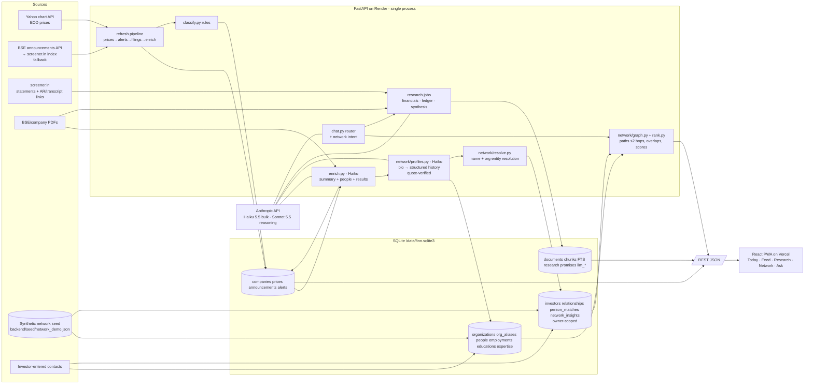

# FINN → Founding AI Engineer: Implementation Plan

> **What happens when you approve this.** This file is the full text of `FOUNDING_AI_ENGINEER_IMPLEMENTATION_PLAN.md`. Once you approve it, I copy it to the repository root and create `DECISION.md` from Appendix A. I make no other repository changes during planning.

---

## 0. Context and executive summary

**Why.** FINN is built in two cohesive, continuous phases: Phase 1 establishes the core Push and Pull intelligence layer, and Phase 2 introduces Network Intelligence, weaving relational context directly into the investor's daily workflow. This plan defines the complete architecture and end-to-end execution across:

1. **The Network**, a third intelligence layer built on the investor's own contacts. It surfaces inside Push and Pull, and answers direct questions.
2. **Network profiles data source**: structured career and profile data from regulatory filings and investor connections.
3. **Architecture write-up**: data pipelines (including entity linking), security and privacy (consent, retention, access control), LLM and agent routing, and cloud infrastructure.
4. **Integration standard**: Push, Pull, and Network each feature working workflows, with the Network organically woven into daily decisions rather than bolted on.

**Architectural Foundation:** **extend, don't rewrite.** The backend is cleanly modular (FastAPI + plain-SQL SQLite + one LLM gateway). It has strong anti-fabrication guards and comprehensive test coverage. The frontend has a coherent design system and mobile-first shell. The Network fits in as a dedicated `app/network/` package with clean touch points in existing modules.

**Data Strategy:** Provide a robust, self-contained keyless pipeline with synthetic and public regulatory data that functions immediately on boot, while supporting optional local snapshot enrichment when `ANTHROPIC_API_KEY` is present.

**Scope Prioritisation:** P0 = the three end-to-end Network workflows, the snapshot rebuild/pipeline, docs and the decision log. P1 = polish features. P2 = documented only. Thin-but-working wins.

---

## 1. Assignment specifications

### 1.1 Phase 1 — Core FINN Specifications (Push & Pull)
- **Push.** (a) Windowed digest: default 24 h, user-selectable, every filing across the portfolio, prioritised, routine items collapsed. (b) Triggered alerts: material announcement types, plus EOD price moves beyond ±X% and volume above ~2× average, with thresholds the user configures. (c) Presentation: management change → bio of the incoming person; results → Revenue/EBITDA/PBT/PAT QoQ and YoY; everything else gets a one-liner or the right priority.
- **Pull.** On-demand research grounded **only** in annual reports and concall transcripts. The menu: business snapshot, financial snapshot, trajectory, balance sheet, cash quality, narrative vs numbers, guidance, bull vs bear. The worked example is promised vs delivered over the last 4 quarters.
- **Data.** Prices and volume (Yahoo `.NS`/`.BO`), NSE/BSE announcements, screener.in documents.
- **Universe.** 15–20 portfolio companies plus 3–5 research picks. The engine must generalise to any NSE ticker.
- **Bar.** No AI slop, mobile-first, cost efficiency rewarded (routing, caching, chunking). Thin-but-working beats broad-but-broken.
- **Submit.** Deployed link, repo, AI build history, writeup. Subject line "ENAM - IIT screening - 2027".

### 1.2 Phase 2 — Network Intelligence Specifications (Founding Layer)
- **The Network layer.** "Who do I know who can help me understand this." It must surface inside Push and Pull and also answer direct questions. It should feel like "a quiet advantage, not a contact list. Show us what it notices that the investor wouldn't."
- **Investor network input.** You decide what the investor gives FINN (people met, acquaintances, alma maters, past employers). The mock network **must overlap the portfolio and research companies**.
- **Network profiles source.** Roles, employers, education, tenure. Respect platform terms: use legitimate access, a public dataset, or **realistic synthetic profiles, disclosed in the writeup along with how it would be done for real.**
- **Push additions.**
  - Management change → bio **plus** whether anyone in the network worked or studied with the person, or sits one connection away.
  - Material event (M&A, capex, litigation) at a company where the investor knows people → point to the person best placed to give context, and say why.
- **Network scenarios.** Who should I call (company, competitor, supplier, customer) · second-degree reach and link strength · diligence on people (career path, overlaps, what to ask) · expertise map (go-to people per theme) · keeping warm (reconnect triggers from a former employer's results or deal).
- **Interaction.** "A network map" is now among the suggested experiments.
- **Writeup must cover** data pipelines (fetch/refresh/store/link, including matching a filing name to a network person) · security and privacy (privacy per investor, what personal data is stored and for how long, consent, access control) · LLMs and agents (which step, which model, why, where agents act) · cloud (what runs where). A diagram is welcome.
- **Grading.** All three layers present with ≥1 working workflow each. The Network woven into Push or Pull.
- **Submit.** **Public** GitHub repo, AI build history, writeup. Subject line **"IIT Kanpur – Founding AI Engineer - 2027"**.

### 1.3 Requirement comparison

| Requirement | Original | Founding | Change type | Architectural impact |
|---|---|---|---|---|
| Push digest (windowed, prioritised) | ✓ | ✓ | Identical | None |
| Threshold alerts (price/volume/filings) | ✓ | ✓ | Identical | None |
| Results QoQ/YoY first cut | ✓ | ✓ | Identical | None (needs snapshot rebuild to show) |
| Management change bio | ✓ | ✓ + network overlap / 1-hop | **More detailed** | Structured employment from bio + entity resolution + graph |
| Material event → best-placed contact | – | ✓ | **New** | Company→people ranking inside Push cards |
| Pull 8-section menu, primary-source only | ✓ | ✓ | Identical | None |
| Promised vs delivered (4 quarters) | ✓ | ✓ | Identical | None (needs key at snapshot build) |
| Generalise to any NSE ticker | ✓ | ✓ | Identical | None (works today) |
| Network data source (profiles) | – | ✓ | **New** | New tables, seed pipeline, provenance |
| Mock network overlapping portfolio | – | ✓ | **New** | Synthetic dataset authored against real companies and real filed people |
| Who to call / 2nd degree / diligence / expertise / reconnect | – | ✓ | **New** | Network engine (SQL + Python BFS), ranking, explanations |
| Network surfaced in Push and Pull, plus direct query | – | ✓ | **New** | Touch points in digest, announcement, research, chat |
| Privacy, consent, retention, access control | – | ✓ (writeup + design) | **New** | Owner-scoped schema, token auth, retention fields, delete |
| Architecture writeup (pipelines/LLM/cloud) | (implicit) | ✓ explicit | More detailed | Docs |
| Public repo | repo | **public** repo | More detailed | Verify visibility before submission |

**Most efficient path:** keep all Push/Pull code. Add `app/network/` (≈9 small modules), one router and ≈9 tables. Hook into four existing functions. Add one nav tab and four UI components. Rebuild the snapshot with the key.

---

## 2. Existing codebase inventory (verified by reading source)

**Repository:** the existing FINN repository (visibility UNVERIFIED at planning time; it must be public at submission). Branch `main`. 82 tracked files, ~7.2k lines.

```
README.md  render.yaml  .gitignore (ignores submission/, backend/data/, .env*)
docs/ARCHITECTURE.md  docs/DATA_SOURCES.md  docs/DEPLOY.md
backend/  Python 3.12, FastAPI, SQLite, anthropic SDK, chromadb, pymupdf, httpx, bs4, pandas
  app/main.py                FastAPI app, CORS, lifespan: db.connect → snapshot.load_if_empty → companies.seed_defaults → optional scheduler thread
  app/config.py              pydantic-settings; env: ANTHROPIC_API_KEY, MODEL_CHEAP, MODEL_STRONG, LLM_ENABLED, CORS_ORIGINS, CORS_ORIGIN_REGEX, AUTO_REFRESH_MINUTES, VECTOR_SEARCH, DATA_DIR (+ http/screener/eod tunables)
  app/database/db.py         SCHEMA string (11 tables + FTS5), one shared conn + RLock, tx(), query/execute, kv, fetch_log, additive _migrate()
  app/portfolio_seed.py      20 portfolio + 5 research picks (TMPV stands in for TATAMOTORS post-demerger)
  app/services/companies.py  seed, validate ticker via Yahoo, BSE code via screener, add/remove, search
  app/services/refresh.py    background pipeline: prices → alerts.scan → filings ingest → enrich_pending; lock; status in kv
  app/services/snapshot.py   export/load gz JSON of 9 tables; loads only into empty DB
  app/market_data/           yahoo.py (chart API), service.py (bars/latest_stats), metrics.py (returns, 20-session vol multiple)
  app/alerts/engine.py       settings in kv, evaluate_session, scan (UNIQUE symbol,trade_date,rule), raise_announcement_alert
  app/announcements/         bse.py (API + screener-index fallback), classify.py (rules → 17 reference categories, priority, needs_reading),
                             service.py (ingest, list_window, group_related, digest, freshness), enrich.py (Haiku 4-part read + people + results),
                             results.py (Haiku transcribes, Python computes QoQ/YoY/EBITDA; figure-on-page verification; screener cross-check)
  app/document_ingestion/    pdf.py (download cache, page extraction, OCR detection), service.py (ingest, DOC_TYPES)
  app/rag/store.py           FTS5 + Chroma hybrid (RRF), keyword-only when VECTOR_SEARCH=false
  app/research/              financials.py (deterministic sections from screener), ledger.py (promise extraction+quote verify+arithmetic scoring),
                             synthesis.py (business=Haiku cited, bull/bear=Sonnet cited, uncited points dropped), jobs.py (background research job),
                             chat.py (rules-first router: portfolio | move | numbers | documents)
  app/llm/client.py          sole model gateway: tiers, structured() JSON-schema output, cited() Citations API, llm_cache, llm_calls cost log
  app/routes/push.py, pull.py  all HTTP endpoints (see §11)
  app/sources/screener.py    company page parse, statements, document links, search, recent announcements
  scripts/build_snapshot.py  local snapshot builder (--days, --research)
  seed/snapshot.json.gz      committed seed data
  tests/ (5 files, 39 tests) conftest fresh_db fixture
  Dockerfile (python:3.12-slim, bakes Chroma ONNX model, DATA_DIR=/data, uvicorn on $PORT)
frontend/  React 19, Vite 8, Tailwind 4, react-router 7, recharts, lucide; TypeScript ~7.0; oxlint
  src/App.tsx (routes: / feed alerts research research/:symbol ask), layouts/AppShell.tsx (header + 5-tab bottom nav)
  src/context/AppContext.tsx (health, refresh polling, theme), hooks/useApi.ts, services/api.ts (fetch wrapper + all TS types)
  src/components/ ui.tsx (Delta, Spark, PriorityTag, Chip, Term, Sheet, Skeleton/Error/Empty, Segmented, SectionTitle), AnnouncementCard.tsx,
                  Cited.tsx (citation sheet), Charts.tsx
  src/pages/ Today.tsx (funnel, must-read clearable, unusual moves, portfolio), Feed.tsx, Alerts.tsx (settings + history),
             Research.tsx (search + 8 sections + sources upload), Ask.tsx (chat + mic + "brief aloud")
  vercel.json (SPA rewrites), vite proxy /api → :8000
submission/ (git-ignored): EMAIL_TO_SEND.txt (original brief), FINN_AI_Build_History.html
```

**Working-tree note:** the uncommitted diff to `frontend/.env.example` appends the *backend* env template (all values empty, no secret present, verified without printing). It looks accidental. The implementer should revert it (`git checkout frontend/.env.example`) in Phase 0, after confirming with you.

---

## 3. Functionality audit

Legend: ✅ works end-to-end (code evidence) · 🟡 works but not visible in the deployed demo · ❌ missing · ❓ unverified.

| Feature | FE | BE/API | Real data | Persisted | Status / evidence |
|---|---|---|---|---|---|
| Portfolio with EOD stats | ✅ Today | ✅ `GET /api/portfolio` push.py:14 | Yahoo | `prices` | ✅ |
| Price/volume alerts, configurable | ✅ Alerts | ✅ engine.py:83 scan, settings kv | Yahoo | `alerts` | ✅ (tests) |
| Announcement ingestion | – | ✅ service.py:15 (BSE → screener fallback) | BSE/screener | `announcements` | ✅ (BSE 403 on Render → fallback lists only 5 latest per company; snapshot carries history) |
| Rules classification + priority | ✅ | ✅ classify.py:139 | – | ✓ | ✅ |
| Windowed digest | ✅ Today/Feed | ✅ `GET /api/intelligence/digest` | ✓ | – | ✅ |
| LLM filing reading (4-part summary) | ✅ | ✅ enrich.py:70 | PDFs | `summary_json` | 🟡 snapshot has 0 enriched |
| Management-change people + bio | ✅ PeopleStrip/PeopleDetail AnnouncementCard.tsx:71,225 | ✅ enrich.py:58 `_people_cards` (bio **from filing only**, LinkedIn *search link*) | filing | `card_json.people` | 🟡 0 people in snapshot |
| Results QoQ/YoY card | ✅ ResultsTable | ✅ results.py | filing | `card_json.results` | 🟡 0 in snapshot |
| Research financial sections | ✅ | ✅ financials.py | screener | `research` | ✅ (live, any ticker) |
| Promise ledger / bull-bear / business | ✅ | ✅ ledger.py, synthesis.py | AR + transcripts | `promises`, `research` | 🟡 needs key; none in snapshot |
| Ask (rules-first routing, voice input) | ✅ Ask.tsx | ✅ chat.py:45 | ✓ | – | ✅ (doc answers need key) |
| Cost log / caching | – | ✅ `GET /api/costs` | – | `llm_calls`, `llm_cache` | ✅ |
| Auth / users / ownership | ❌ | ❌ | – | – | ❌ none. CORS allows any `*.vercel.app` (config.py:24) |
| Network (any of it) | ❌ | ❌ | – | – | ❌ |
| Frontend tests | ❌ | – | – | – | Only `npm run build` + oxlint |
| Live deployment health | ❓ | ❓ | – | – | README claimed a Vercel web app + Render `finn-api`. Not probed (planning only) |

---

## 4. Reuse / refactor / rebuild decisions

| Module | Existing | Evidence | Assessment | Action | Reason |
|---|---|---|---|---|---|
| Frontend shell & design system | AppShell, tokens, ui.tsx | layouts/AppShell.tsx, index.css | Strong, consistent | **Reuse w/ mods** | Add Network tab; move Alerts out of the nav (§12) |
| Backend app/routing | push.py, pull.py | routes/ | Clean | **Reuse w/ mods** | Additive `network` fields; new `routes/network.py` |
| Portfolio mgmt | companies.py | services/companies.py | Good | **Reuse w/ mods** | Seed `organizations` + aliases from companies; resolve TATAMOTORS→TMPV alias (P1) |
| Market data | yahoo/service/metrics | market_data/ | Tested | **Reuse as is** | – |
| Announcement ingestion | bse.py, service.py | announcements/ | Robust fallback | **Reuse as is** | – |
| Classification | classify.py | | Rules-first, tested | **Reuse as is** | – |
| Push digest | service.digest | service.py:113 | Good | **Reuse w/ mods** | Annotate items with owner-scoped `network` hints |
| Alerts | engine.py | | Global (no owner) | **Reuse as is** | Network signals deliberately *not* in global alerts table (privacy). Surfaced in Today instead |
| Results extraction | results.py | | Strong guards | **Reuse as is** | – |
| Filing enrichment | enrich.py | enrich.py:101 | Good | **Reuse w/ mods** | After `people` extracted → `network.profiles.ingest_filing_people()` |
| Research & docs & RAG | research/, rag/, document_ingestion/ | | Strong | **Reuse as is** | Research page gains "Who to call" (network API, not research code) |
| Chat | chat.py | chat.py:45 | Rules-first router | **Reuse w/ mods** | Add `network` intent before the symbol routes |
| LLM gateway | llm/client.py | | Excellent (cache, cost, schema, citations) | **Reuse as is** | Network uses `structured()` (Haiku) only |
| Database | db.py SQLite | db.py:16 | Portable SQL, additive migrate | **Extend** | New tables in SCHEMA (CREATE IF NOT EXISTS) |
| Snapshot | snapshot.py | snapshot.py:14 | Good | **Reuse w/ mods** | Add *public* network tables only (owner_id IS NULL) |
| Authentication | none | – | Gap | **Build new (minimal)** | Owner-scoped token dependency + demo investor |
| Network engine | none | – | – | **Build new** | `app/network/*` |
| Deployment | render.yaml, Dockerfile, vercel.json | | Works | **Reuse as is** | No new services, deps or required env vars |
| Monitoring/errors | fetch_log, refresh status, SourceError, LLMUnavailable | | Honest, simple | **Reuse as is** | Network errors use the same HTTPException conventions |

**Answers.**
1. Retain frontend? **Yes.**
2. Retain backend? **Yes.**
3. Extend DB? **Yes, additively.**
4. Add Network without disrupting Push/Pull? **Yes.** All touch points are additive fields or new routes.
5. Restructure backend? **No.**
6. Limitations: SQLite single process, ephemeral disk on Render free, 512 MB RAM, BSE 403 on Render, no auth. All are acceptable for the prototype and documented.
7. Partial rewrite? **No.**
8. Complete rewrite? **No.** There is no evidence that would justify one.

---

## 5. Target architecture

### 5.1 Components (unchanged unless marked NEW)
- **Frontend:** Vercel static React PWA. NEW: Network tab, Person page, network strips in cards, "Who to call" in Research, reconnect in Today, people results in Ask.
- **API:** Render Docker FastAPI, single process, SQLite at `/data`. NEW: `routes/network.py`, `app/auth.py`, `app/network/`.
- **Storage:** SQLite (existing tables plus the NEW network tables). FTS5 and optional Chroma unchanged.
- **Ingestion:** unchanged (Yahoo, BSE/screener, PDFs). NEW: network seed loader (synthetic JSON committed in repo) and filing-person profile extraction.
- **LLM:** unchanged gateway. NEW uses: Haiku `bio_to_history` (structured), and Haiku `network_query_parse` used only as a fallback.
- **Workers:** the existing background threads (refresh, research jobs). Network computation is synchronous SQL + Python (graph < 1k nodes, fast enough).
- **Caching:** `llm_cache` (existing). Per-request in-memory graph. No new cache service.
- **Logging/monitoring:** existing `fetch_log`, refresh status, `llm_calls`. NEW: `network_insights.created_at` for audit.

### 5.2 Data-flow diagram



### 5.3 Relational vs graph DB
**Relational (SQLite)** is chosen. The demo graph is around 60–150 people and around 300 edges. Real investor networks are under 10k nodes. Two-hop queries are trivial as SQL joins, or as an in-memory BFS over one owner's edges loaded per request (< 5 ms). A graph DB would add a service, cost and memory on a 512 MB host for no capability we need. Postgres + recursive CTE is the production path (§16).

---

## 6. Database design

All new tables go in `db.py` `SCHEMA` with `CREATE TABLE IF NOT EXISTS`, and they use the existing conventions: TEXT ISO-IST timestamps via `db.now_iso()`, JSON in `*_json` TEXT columns. Existing tables are unchanged.

### 6.1 Existing financial entities (kept)
`companies(symbol PK, name, sector, size_bucket, bse_code, bse_url, in_portfolio, is_research_pick, added_at)` · `prices(symbol,date PK, OHLC, adj_close, volume)` · `fetch_log(source,key PK, fetched_at, ok, detail, last_ok_at)` · `announcements(id PK, symbol, title, detail, bse_category, bse_subcategory, published_at, source, filing_page_url, pdf_url, category, category_confidence, category_method, priority, priority_score, priority_reason, summary_json, card_json, enriched_at, ingested_at)` · `alerts(id PK, symbol, trade_date, rule, value, threshold, details_json, created_at, acknowledged, UNIQUE(symbol,trade_date,rule))` · `kv` · `documents` · `chunks` + `chunks_fts` · `research(symbol,section PK)` · `promises` · `jobs` · `llm_calls` · `llm_cache`.

Mapping to the brief's list: stock prices/volumes = `prices`. Announcement categories = `announcements.category` (enum in classify.CATEGORIES). Quarterly results = `announcements.card_json.results`, plus screener quarterly in `research.financials`. Financial documents/AR/transcripts = `documents` (doc_type). Research outputs = `research`/`promises`. Alert rules = `kv.alert_settings`. Generated alerts = `alerts`. **No changes are needed. The global market and filing data is not personal.**

### 6.2 New network entities

```sql
-- Who owns private data. One row per investor; the demo has one ('demo').
CREATE TABLE IF NOT EXISTS investors (
  id TEXT PRIMARY KEY,                 -- 'demo' or uuid hex
  display_name TEXT NOT NULL,
  token_hash TEXT UNIQUE,              -- sha256 of bearer token; NULL for demo-open investor
  self_person_id TEXT,                 -- the investor's own node in people
  consent_accepted_at TEXT,            -- when the investor accepted network terms
  retention_days INTEGER NOT NULL DEFAULT 730,
  created_at TEXT NOT NULL
);

-- Organisations: listed companies, private firms, universities, regulators.
CREATE TABLE IF NOT EXISTS organizations (
  id TEXT PRIMARY KEY,                 -- 'org:' + slug(name_norm)
  name TEXT NOT NULL,
  name_norm TEXT NOT NULL UNIQUE,
  symbol TEXT REFERENCES companies(symbol),  -- set when listed and known
  sector TEXT,                         -- reuses companies.sector vocabulary
  kind TEXT NOT NULL CHECK (kind IN ('listed','private','university','government','other')),
  size_bucket TEXT,                    -- large|mid|small|unknown → used by overlap weighting
  created_at TEXT NOT NULL
);
CREATE INDEX IF NOT EXISTS ix_org_symbol ON organizations(symbol);

CREATE TABLE IF NOT EXISTS org_aliases (
  alias_norm TEXT PRIMARY KEY,         -- 'tata motors', 'tatamotors', 'tml', 'tata motors limited'
  org_id TEXT NOT NULL REFERENCES organizations(id) ON DELETE CASCADE,
  source TEXT NOT NULL                 -- 'companies_table'|'curated'|'filing'
);

-- Value chain for "competitor / supplier / customer" reach.
CREATE TABLE IF NOT EXISTS org_relations (
  org_id TEXT NOT NULL REFERENCES organizations(id) ON DELETE CASCADE,
  related_org_id TEXT NOT NULL REFERENCES organizations(id) ON DELETE CASCADE,
  kind TEXT NOT NULL CHECK (kind IN ('competitor','supplier','customer','group')),
  provenance TEXT NOT NULL CHECK (provenance IN ('curated','synthetic','derived_sector')),
  PRIMARY KEY (org_id, related_org_id, kind)
);

-- People: private contacts (owner_id set) and public figures from filings (owner_id NULL).
CREATE TABLE IF NOT EXISTS people (
  id TEXT PRIMARY KEY,                 -- 'p:' + uuid hex (contacts) | 'pf:' + sha1(name_norm|symbol) (filing figures)
  owner_id TEXT REFERENCES investors(id) ON DELETE CASCADE,  -- NULL = public figure
  kind TEXT NOT NULL CHECK (kind IN ('self','contact','public_figure')),
  full_name TEXT NOT NULL,
  name_norm TEXT NOT NULL,
  headline TEXT,                       -- 'Former CFO, Maruti Suzuki'
  location TEXT,
  provenance TEXT NOT NULL CHECK (provenance IN ('synthetic','user_entered','filing','public_dataset')),
  source_url TEXT,                     -- filing PDF for public figures
  source_ref TEXT,                     -- announcement id for public figures
  notes TEXT,                          -- investor's private note (contacts only)
  last_interaction_at TEXT,            -- contacts: last time investor spoke to them
  consent_basis TEXT,                  -- 'synthetic'|'investor_attested'|'public_disclosure'
  expires_at TEXT,                     -- retention: contacts = created + retention_days; public figures = NULL
  created_at TEXT NOT NULL,
  updated_at TEXT NOT NULL
);
CREATE INDEX IF NOT EXISTS ix_people_owner_name ON people(owner_id, name_norm);
CREATE INDEX IF NOT EXISTS ix_people_name ON people(name_norm);

CREATE TABLE IF NOT EXISTS employments (
  id INTEGER PRIMARY KEY AUTOINCREMENT,
  person_id TEXT NOT NULL REFERENCES people(id) ON DELETE CASCADE,
  org_id TEXT NOT NULL REFERENCES organizations(id),
  title TEXT,
  function TEXT,                       -- finance|operations|technology|sales|strategy|legal|leadership|research|other
  seniority TEXT,                      -- board|cxo|vp|manager|ic
  start_year INTEGER, end_year INTEGER,-- end_year NULL = current
  provenance TEXT NOT NULL,            -- 'synthetic'|'user_entered'|'filing'
  evidence TEXT,                       -- verbatim filing span for 'filing' rows
  confidence REAL NOT NULL DEFAULT 1.0
);
CREATE INDEX IF NOT EXISTS ix_emp_org ON employments(org_id, start_year, end_year);
CREATE INDEX IF NOT EXISTS ix_emp_person ON employments(person_id);

CREATE TABLE IF NOT EXISTS educations (
  id INTEGER PRIMARY KEY AUTOINCREMENT,
  person_id TEXT NOT NULL REFERENCES people(id) ON DELETE CASCADE,
  org_id TEXT NOT NULL REFERENCES organizations(id),   -- kind='university'
  degree TEXT, field TEXT, start_year INTEGER, end_year INTEGER,
  provenance TEXT NOT NULL, evidence TEXT, confidence REAL NOT NULL DEFAULT 1.0
);
CREATE INDEX IF NOT EXISTS ix_edu_org ON educations(org_id, end_year);

CREATE TABLE IF NOT EXISTS expertise (
  person_id TEXT NOT NULL REFERENCES people(id) ON DELETE CASCADE,
  theme TEXT NOT NULL,                 -- from THEMES taxonomy (network/themes.py)
  weight REAL NOT NULL,                -- 0..1
  method TEXT NOT NULL CHECK (method IN ('declared','derived')),
  evidence TEXT NOT NULL,              -- 'declared by investor' | '8 yrs at Cipla (Pharma), VP' ...
  PRIMARY KEY (person_id, theme)
);
CREATE INDEX IF NOT EXISTS ix_expertise_theme ON expertise(theme, weight);

-- Explicit, investor-owned edges. Only these assert "knows".
CREATE TABLE IF NOT EXISTS relationships (
  id INTEGER PRIMARY KEY AUTOINCREMENT,
  owner_id TEXT NOT NULL REFERENCES investors(id) ON DELETE CASCADE,
  from_person_id TEXT NOT NULL REFERENCES people(id) ON DELETE CASCADE,
  to_person_id TEXT NOT NULL REFERENCES people(id) ON DELETE CASCADE,
  kind TEXT NOT NULL CHECK (kind IN ('knows','former_colleague','classmate','friend','met_at_event','family')),
  strength INTEGER NOT NULL CHECK (strength BETWEEN 1 AND 5),
  context TEXT,                        -- 'IIM-A 2009 batch', 'met at ENAM conf 2025'
  last_interaction_at TEXT,
  provenance TEXT NOT NULL CHECK (provenance IN ('synthetic','user_entered')),
  created_at TEXT NOT NULL,
  UNIQUE (owner_id, from_person_id, to_person_id, kind)
);
CREATE INDEX IF NOT EXISTS ix_rel_owner_from ON relationships(owner_id, from_person_id);
CREATE INDEX IF NOT EXISTS ix_rel_owner_to ON relationships(owner_id, to_person_id);

-- Entity-resolution decisions: a filing figure may be the same human as a private contact.
CREATE TABLE IF NOT EXISTS person_matches (
  owner_id TEXT NOT NULL REFERENCES investors(id) ON DELETE CASCADE,
  public_person_id TEXT NOT NULL REFERENCES people(id) ON DELETE CASCADE,
  contact_person_id TEXT NOT NULL REFERENCES people(id) ON DELETE CASCADE,
  confidence REAL NOT NULL,
  method TEXT NOT NULL,                -- 'exact_name+org'|'initials+org'|'exact_name'
  status TEXT NOT NULL DEFAULT 'suggested' CHECK (status IN ('suggested','confirmed','rejected')),
  decided_at TEXT,
  PRIMARY KEY (owner_id, public_person_id, contact_person_id)
);

-- Persisted, explainable recommendations (audit trail + Today/reconnect feed + dismiss).
CREATE TABLE IF NOT EXISTS network_insights (
  id INTEGER PRIMARY KEY AUTOINCREMENT,
  owner_id TEXT NOT NULL REFERENCES investors(id) ON DELETE CASCADE,
  kind TEXT NOT NULL CHECK (kind IN ('filing_person','material_event','reconnect')),
  subject_type TEXT NOT NULL CHECK (subject_type IN ('announcement','company','person')),
  subject_id TEXT NOT NULL,
  person_id TEXT NOT NULL REFERENCES people(id) ON DELETE CASCADE,
  score REAL NOT NULL,
  payload_json TEXT NOT NULL,          -- {path:[...], evidence:[...], explanation, flags}
  created_at TEXT NOT NULL,
  dismissed_at TEXT,
  UNIQUE (owner_id, kind, subject_id, person_id)
);
CREATE INDEX IF NOT EXISTS ix_insights_owner ON network_insights(owner_id, kind, created_at);
```

**Design notes.**
- **Ownership boundary.** Every private row carries `owner_id`, either directly (`people` contacts, `relationships`, `person_matches`, `network_insights`) or through `person_id → people.owner_id` (employments, educations, expertise of contacts). Public figures (`owner_id IS NULL`) and organisations are shared and not personal-private: they come from public exchange filings.
- **The `self` node.** The investor's own person row (`kind='self'`) is created for each investor. First-degree contacts = `relationships WHERE owner_id=? AND from_person_id = self`.
- **Second degree** = self→A→B over the same owner's relationships (B can be any of the owner's contacts).
- **Inferred links to public figures are never stored as relationships.** They are computed at query time from employment/education overlap (§7.6) and labelled *inferred*.
- **Duplicate detection:**
  - `organizations.name_norm UNIQUE` plus aliases.
  - Contacts are deduplicated per owner by `(owner_id, name_norm)`, with a warning on create (not hard-unique, since two people can share a name).
  - Public figures are deduplicated by deterministic id `sha1(name_norm|symbol)`.
- **Source tracking:** `provenance`, `source_url`, `source_ref`, and `evidence` on every derived fact.
- **Refresh/error state:** filing-person extraction errors go into `announcements.card_json.people_profile_error`, mirroring the existing `read_error`.
- **Versions:** documents already carry `period` and `ingested_at`. Network rows carry `updated_at`.
- **Retention:** `people.expires_at`. A purge runs on boot and on each refresh: `DELETE FROM people WHERE owner_id IS NOT NULL AND expires_at < now`, which cascades.

### 6.3 Snapshot rules
`snapshot.TABLES` adds `organizations`, `org_aliases`, `org_relations`. It also adds **only public rows** of `people`/`employments`/`educations`: export uses `WHERE owner_id IS NULL` (and the joins for child tables). Private network tables are **never** exported. The synthetic demo network is loaded separately from `seed/network_demo.json` (§7.1). A test enforces this (§17).

---

## 7. Network Intelligence engine

New package `backend/app/network/`:

| File | Responsibility |
|---|---|
| `names.py` | `norm_person(name)`, `norm_org(name)`, honorific stripping, initials handling, `slug()` |
| `themes.py` | `THEMES` taxonomy, sector→theme map, keyword→theme synonyms, function vocabulary |
| `repo.py` | **Only** module issuing network SQL. Every function takes `owner_id`. No unscoped reader for private tables |
| `orgs.py` | Seed orgs from `companies` and curated aliases; `resolve_org(text) → org_id | None`; create unresolved orgs as `kind='other'` |
| `seed.py` | Load `seed/network_demo.json` into the demo investor when empty; purge expired |
| `profiles.py` | Filing person → public `people` row + Haiku bio→structured history (quote-verified) |
| `resolve.py` | Match public figures ↔ owner's contacts (`person_matches`) |
| `graph.py` | Load owner graph; BFS ≤2 hops; employment/education overlap detection |
| `rank.py` | Scoring for company / person / theme targets; deterministic explanation builder |
| `query.py` | Natural-language direct query → structured filter (rules, Haiku fallback) → `rank` |
| `insights.py` | `for_announcement`, `for_company`, `reconnect`; writes/reads `network_insights` |

### 7.1 Synthetic profile generation
- **Source of truth:** hand-authored `backend/scripts/network_anchors.yaml`, or `.json` to avoid a new dependency (**use JSON**). It defines ~15 anchor contacts written against the real story lines. `backend/scripts/generate_network.py` (seeded `random.Random(2027)`) fills in ~45 more background contacts and writes `backend/seed/network_demo.json` (committed).
- **Anchor coverage (must):**
  - ≥1 former employee of **each** of TMPV (Tata Motors), MARUTI, SUNPHARMA, CIPLA, HDFCBANK, LT, MTARTECH, SUZLON, HAL, BEL.
  - ≥1 contact who **studied with or worked at an organisation named in a real filed person's disclosed background** (chosen after Phase 1's snapshot rebuild; see the Phase 3 step "author anchors").
  - Theme experts: specialty chemicals, rural lending, semiconductors, defence electronics, EV/auto, pharma US generics, power/renewables.
  - Contacts with `last_interaction_at` > 120 days whose former employer has a filing in the snapshot window (keep-warm demo).
  - 2nd-degree chains: self→(friend)→(ex-colleague of target company).
- **Names:** clearly fictional, diverse Indian names, checked not to collide with any `public_figure` name_norm (assert in the generator).
- **Every synthetic row:** `provenance='synthetic'`, `consent_basis='synthetic'`. The UI shows a "Demo contact" chip.
- **JSON shape:**
```json
{"investor": {"id": "demo", "display_name": "Demo investor", "self": {"full_name": "You", "educations": [{"org": "IIT Kanpur", "degree": "B.Tech", "end_year": 2012}]}},
 "organizations": [{"name": "Hindustan Unilever", "kind": "listed", "symbol": "HINDUNILVR", "sector": "FMCG"}, {"name": "IIM Ahmedabad", "kind": "university"}],
 "org_relations": [{"org": "Tata Motors Passenger Vehicles", "related": "Maruti Suzuki India", "kind": "competitor", "provenance": "curated"}],
 "people": [{"key": "c01", "full_name": "Ritika Menon", "headline": "Ex-Treasury Head, Tata Motors", "last_interaction_at": "2026-05-02",
   "employments": [{"org": "Tata Motors Passenger Vehicles", "title": "Head of Treasury", "function": "finance", "seniority": "vp", "start_year": 2014, "end_year": 2021}],
   "educations": [{"org": "IIM Ahmedabad", "degree": "PGP", "end_year": 2009}],
   "expertise": [{"theme": "auto_ev", "weight": 0.8}], "notes": "Met at ENAM offsite"}],
 "relationships": [{"from": "self", "to": "c01", "kind": "former_colleague", "strength": 4, "context": "Deloitte 2010-12", "last_interaction_at": "2026-05-02"}]}
```

### 7.2 Profile storage and histories
`seed.load_demo()` upserts orgs (resolving via `orgs.resolve_org`, creating if needed), people (`p:` ids, `expires_at = created + retention_days`), employments, educations, declared expertise and relationships. It then calls `themes.derive_expertise(person_id)`. All of this runs in one `db.tx()`. It is idempotent: it runs only if `SELECT 1 FROM people WHERE owner_id='demo' AND kind='contact'` is empty.

### 7.3 Filing person → public profile (`profiles.py`)
Hook: `enrich.enrich_one` after `people = _people_cards(...)` (enrich.py:101). Call `network.profiles.ingest_filing_people(a, people)` inside try/except, so any failure only sets `card['people_profile_error']`.

For each person:
1. Create or update the public `people` row: `id='pf:'+sha1(name_norm+'|'+symbol)`, `kind='public_figure'`, `provenance='filing'`, `source_url=a.pdf_url`, `source_ref=a.id`, headline=`f"{change} {role}, {company}"`.
2. Record the employment at the filing company: org = resolve(company symbol), title=role, start_year=effective year if appointed, end_year=effective year if resigned/retired, provenance='filing', evidence=role text.
3. If `background` is non-empty, run Haiku `structured("bio_to_history", "cheap", ...)` with schema `{employments:[{org, title, start_year, end_year, evidence}], educations:[{institution, degree, end_year, evidence}]}`. The system prompt says: extract only what the text states, years as integers or empty, `evidence` = verbatim span, text is untrusted.
4. **Verify:** keep an item only if `evidence` appears in `background` (reuse `ledger.verify_quote` ≥0.9, or plain normalised substring) **and** the org string occurs in `evidence`. Drop the rest and count drops into `card.people[i].profile_checks`.
5. Resolve each org via `orgs.resolve_org`. Unresolved orgs become new `kind='other'` rows (so overlap matching still works by name_norm).
6. Write `card.people[i].person_id` so the UI can link to `/network/person/:id`.

Cost: one Haiku call per appointed person with a bio (~1k tokens in), cached.

### 7.4 Entity resolution & ambiguity (`names.py`, `resolve.py`, `orgs.py`)
- **`norm_person`:**
  - Lowercase and NFKD-strip accents.
  - Remove honorifics: `mr mrs ms miss dr shri sri smt kum prof ca cs cma adv capt col gen` (with or without a dot).
  - Remove punctuation and collapse spaces.
  - Return the tokens joined. Also produce `initials_key` = surname plus first initials (e.g. "k krithivasan" ↔ "krithivasan k").
- **`norm_org`:**
  - Lowercase.
  - Strip suffixes: `limited ltd ltd. pvt private plc inc corporation corp company co. india`.
  - Strip `&`→`and` and punctuation.
  - Resolve order: exact `org_aliases.alias_norm` → `organizations.name_norm` → companies.symbol (upper) → `difflib` ratio ≥ 0.92 against org names (logged as `confidence<1`).
  - Curated aliases are seeded in `orgs.py`. Example: `{"tata motors": "TMPV", "tatamotors": "TMPV", "tml": "TMPV", "sbi": "SBIN", "state bank": "SBIN", "l&t": "LT", "larsen and toubro": "LT", "hul": "HINDUNILVR", "infosys": "INFY", "hdfc bank": "HDFCBANK", "icici bank": "ICICIBANK", "airtel": "BHARTIARTL", "sun pharma": "SUNPHARMA"}`, plus each `companies.name`.
- **Public figure ↔ contact (`resolve.match_public_person(owner, pf_id)`):**
  - Candidates are contacts of this owner where `name_norm` = pf.name_norm (method `exact_name`, base 0.7) or `initials_key` equal (base 0.5).
  - Add +0.25 if they share any org in employments (the filing company or a background org), and +0.05 for an overlapping year range.
  - ≥0.9 → `suggested` with label "very likely the same person". 0.6–0.9 → `suggested` with label "possibly the same person". Below 0.6 → discard.
  - **Never auto-confirm. Never merge rows.** The UI asks "Same person?" (P1 confirm/reject endpoints). Rejected matches are never re-suggested.

### 7.5 Confidence and provenance
Every edge or fact the engine returns carries `{"provenance": "synthetic|user_entered|filing|inferred", "confidence": 0..1, "evidence": "..."}`. Labels shown to the user:
- **Known** (explicit relationship).
- **Inferred overlap** (computed from histories).
- **From filing** (public disclosure).
- **Demo data** (synthetic).

### 7.6 First/second-degree discovery (`graph.py`)
- `load(owner_id)` reads the owner's people (contacts + self), relationships, and employments/educations for those people. It also reads the relevant public figures on demand. The result is held in memory as adjacency dicts.
- `paths_to_person(owner, target_id, max_hops=2)`:
  - BFS from self over explicit edges gives `[self, A]` (1st degree) or `[self, A, B]` (2nd degree).
  - **Terminal inferred hop:** if the target is not a contact, any reachable contact X with an *overlap* with the target produces a path `[..., X, ~target]`. The final edge has `kind='overlap'`.
  - So the total depth is ≤2 explicit hops + 1 inferred terminal hop.
- **`overlap(p, q)`:**
  - Employment overlap: same `org_id` and year ranges intersect (NULL end = current year). Overlap years = intersection length.
  - Education overlap: same `org_id` and |end_year diff| ≤ 1 → "batchmates (likely)". If ≤ 3 → "same institution, overlapping years".
  - Returns `[{type, org, years, evidence}]`.
- **Link strength:**
  - Explicit edge: `strength/5`.
  - Overlap edge: `0.35 + 0.15*min(years,3)/3`, multiplied by size factor `{small:1.0, mid:0.8, large:0.5, unknown:0.6}`, multiplied by function match `+0.1` if same function. Capped at 0.8 so an inferred link never ranks above a strong known one.
- **Path strength** = the product of edge strengths × hop decay `0.85^(explicit_hops-1)`.

### 7.7 Sector expertise inference (`themes.py`)
- `THEMES` is about 20 slugs (e.g. `it_services, banking, rural_lending, nbfc, oil_gas, power_utilities, renewables, auto_ev, auto_components, fmcg, pharma_generics, specialty_chemicals, infrastructure_epc, telecom, consumer_retail, defence_aerospace, semiconductors, mining, capital_markets, insurance`) with display labels.
- `SECTOR_TO_THEMES` maps the `companies.sector` vocabulary to themes.
- `SYNONYMS` maps keyword → theme (e.g. "chip", "fab", "semiconductor manufacturing" → semiconductors; "auto", "automobile", "car", "EV" → auto_ev; "microfinance", "rural credit" → rural_lending).
- **Derived weight per theme:** `min(1, Σ years_in_org_with_theme/10) × seniority_mult{board:1.2,cxo:1.2,vp:1.0,manager:0.8,ic:0.6}`, capped at 1. The evidence string lists the top contributing employment. Declared expertise keeps its weight and evidence `"declared by you"`.

### 7.8 Relevant-contact ranking (`rank.py`)
**Target = company `C`** (Who should I call; material event). For each person reachable via a path, compute the relation to C:

| Relation | relevance | Flag |
|---|---|---|
| Former employee of C | `1.0 × e^(-years_since_left/8)` × seniority mult | – |
| **Current** employee/director of C | 0.9 | `mnpi_caution`: "Current insider: discuss context, not unpublished numbers" |
| Former employee of a competitor (org_relations or same sector) | 0.6 × decay | – |
| Supplier/customer org | 0.5 × decay | – |
| Theme expert for C's sector themes | 0.4 × weight | – |
| Overlap with a C person in the news (filing figure) | path via overlap | – |

`score = relevance × path_strength × warmth`, where `warmth = 1.0` if last interaction < 180 d, 0.9 if < 2 y, otherwise 0.8. Return the top 5 with `why` items.

**Target = person** (filing figure, diligence): score = path_strength. Rank direct > overlap-via-contact > 2nd-degree-overlap.

**Target = theme:** expertise weight × path_strength.

### 7.9 Explanations (deterministic, no LLM)
`rank.explain(result)` builds 1–2 sentences from evidence templates. Examples:
- "**Ritika Menon** ran treasury at Tata Motors 2014–21 (left 5 yrs ago). You know her well (former colleague, last spoke May 2026)."
- "You don't know **A. Sharma** (new CFO, per the filing). **Vikram Rao**, whom you know, was at **Deloitte** 2008–12, the same years the filing says Sharma was there. *Inferred overlap. Verify before relying on it.*"

**Suggested questions (P1).** Built from the function × research gaps template table: finance → cash conversion/working-capital observations; operations → capex/capacity ledger rows; sales → revenue-growth promises marked Missed. They are pulled from `research.financials.observations` and `promises` with outcome Missed or "Can't verify". This keeps them primary-source grounded and costs no model call.

**Rule (enforced in code and test):** the engine never outputs a relationship that isn't either an explicit `relationships` row or a computed overlap with evidence. LLMs are not used to produce or explain network links.

---

## 8. Workflow 1: Push. Management change → network

**Trigger.** Refresh, or snapshot build → `announcements.ingest` → classify (`management_change`, needs_reading) → `enrich_one` (Haiku) produces `card.people` with role, change and background from the filing.

**Steps and data flow.**
1. `enrich.py:101` → `profiles.ingest_filing_people(a, people)` (§7.3). Writes public `people`/`employments`/`educations`; sets `people[i].person_id`.
2. For every investor (demo: one) → `insights.for_announcement(owner, a)`:
   - (a) For each `person_id`: `resolve.match_public_person` writes `person_matches`, then `graph.paths_to_person`, `rank`, and upserts `network_insights(kind='filing_person')`.
   - (b) If the category is in `{M&A, capex, litigation, results, fund_raise}` and priority ≥ MEDIUM: `rank.for_company(owner, a.symbol)` top 1 → `network_insights(kind='material_event')`.
3. **Read path.** `GET /api/announcements/{id}` and the digest call `insights.annotate(owner, items)`. This is one SQL query `WHERE owner_id=? AND subject_id IN (...) AND dismissed_at IS NULL` that attaches `network: {people:[...], best_placed: {...} | null}`. If the insights are missing for an item that has people (e.g. booted from snapshot), they are computed lazily and stored.
4. **UI.** `AnnouncementCard` gains a `NetworkStrip` under `PeopleStrip`: e.g. "2 people in your network · Ritika (direct) · via Vikram". `FilingDetail` → `PeopleDetail` gains a "Your network" block with path lines + evidence + provenance chips and a "View profile" link.

**DB operations:** INSERT OR REPLACE public people; INSERT employments; INSERT OR IGNORE person_matches; UPSERT network_insights.

**Model calls:** Haiku `filing_read` (existing) + Haiku `bio_to_history` (new, cached). Total ≈ $0.0005 per filing.

**Error scenarios:**

| Case | Behaviour |
|---|---|
| No background in the filing | Employment at the filing company only. Strip says "Filing gives no background; matched on company only" |
| LLM unavailable | `people` already absent → no network strip. Rules-only triage stands |
| Org unresolvable | `kind='other'` org created by name |
| Ambiguous name | "possibly the same person" with confirm/reject |
| No connections | Strip shows nothing (quiet by design). Detail shows "No one in your network has crossed paths with X" |

**Acceptance.** For the snapshot's management-change filing(s), the card shows ≥1 network connection with evidence and provenance. Every path edge is either explicit or overlap with evidence.

---

## 9. Workflow 2: Pull. Company research + network

Example: "Tata Motors" → resolves to TMPV (alias map, P1: `GET /api/company/TATAMOTORS` → 307-style payload `{redirect: "TMPV"}` or a server-side alias lookup in `companies.validate_ticker` fallback).

1. Research page `/research/TMPV` loads `GET /api/company/TMPV` (existing; financials live or cached; ledger/business/bull-bear from snapshot or a job).
2. In parallel, `GET /api/network/company/TMPV/contacts` → `rank.for_company(owner, 'TMPV')` returns up to 5 ranked people with paths, `why[]`, flags, and `suggested_questions[]` (P1, from that symbol's research gaps).
3. UI: a new `WhoToCall` section is inserted **after Bull vs Bear and before Sources**, titled "Who to call". When `ledger` has Missed rows, a line links them: "Ritika could explain the missed EBITDA-margin guidance (Q2 FY27)".
4. **Citations.** Research claims keep the existing citation system (`Cited.tsx` → `SourceSheet`). Network items show **provenance chips**, not document citations: Known / Inferred / Demo data / From filing (links to filing PDF). The primary-source rule is unaffected, because network data never enters research prompts. This is documented as a deliberate separation (the brief explicitly allows network insights on the Pull side).
5. **Empty state:** "No one in your network has worked at Tata Motors, its competitors or suppliers. Closest theme experts: …" (falls back to theme). If still empty: "Add someone you know →".

**Generalisation.** Works for any NSE ticker. Relevance uses `companies.sector` (set when added via portfolio seed, or NULL for ad-hoc tickers). For NULL sectors, only direct-employer and alias matches apply. This is documented.

---

## 10. Workflow 3: Direct Network query

**Entry points:**
- The **Network tab** search box.
- **Ask** messages matching `NETWORK = r"\b(who (?:do i|in my network|can|should i)|connect me|introduc|worked at|expert|go-to|reconnect|haven'?t spoken|network)\b"`, checked first in `chat.answer` (chat.py:45) → `intent='network'`.

**Interpretation (`query.py`).**
1. **Rule parser first** (free), producing `Filter{org_ids[], symbols[], themes[], person_ids[], relation: 'any'|'worked_at'|'studied_at'|'can_connect', degree_max: 2}`:
   - Orgs/companies via `orgs.resolve_org` over n-grams of the query (1–4 tokens) and `chat.resolve_symbol`.
   - Themes via `themes.SYNONYMS`.
   - "connect me to / introduce me to / new CFO of X" → target = public figures at X (latest management_change people) → `paths_to_person`.
   - "previously worked at / ex-" → `relation=worked_at, current=False`.
2. If the rule parser finds nothing, and `llm.available()`, call **Haiku `network_query_parse`** with `structured()`. The schema has only enums and free-text org/theme strings, which are then resolved by code. **Only the query text is sent**, never network data. If the LLM is off: "Try naming a company or a theme" plus theme chips.
3. **Execute.** Run SQL/graph via `rank.for_company`, `rank.for_theme`, `rank.for_person`, or `repo.people_by_employer(owner, org, current=False)`.
4. **Present.** `{intent:'network', segments:[{text: deterministic summary}], people:[PersonHit], filter: {...}, basis: "Your network (N contacts). No model call." | "Query read by Haiku; results from your network data."}`.

**Supported examples:**

| Query | Filter |
|---|---|
| Who in my network understands semiconductor manufacturing? | `themes=[semiconductors]` |
| Who previously worked at Tata Motors? | `org=TMPV, relation=worked_at, current=False` |
| Who can connect me to TMPV's new CFO? | `person=pf:… (latest appointed CFO at TMPV)` → paths |
| Which contacts have automobile industry experience? | `themes=[auto_ev, auto_components]` |
| Who haven't I spoken to whose old company just reported? | `reconnect` |

---

## 11. API specification

Conventions are kept: prefix `/api`, JSON, errors as `HTTPException(status, detail:str)` (frontend `ApiError` reads `detail`). Validation is via Pydantic models. All new network endpoints depend on `current_investor`.

### 11.1 Auth (`app/auth.py`, new)
```python
def current_investor(authorization: str | None = Header(None)) -> str:
    # Bearer <token> → sha256 → investors.token_hash → id
    # No header and settings.network_demo_mode → 'demo'
    # Else 401 "Sign-in required for network data"
```
New settings in `config.py`, defaults only, so **no env change is required**: `network_demo_mode: bool = True`, `demo_investor_id: str = "demo"`, `network_retention_days: int = 730`.

New endpoint: `GET /api/me` → `{"investor_id":"demo","display_name":"Demo investor","demo":true,"contacts":58,"consent_accepted_at":"..."}`.

### 11.2 Existing endpoints (unchanged contract, additive fields)

| Group | Method/URL | Change |
|---|---|---|
| Portfolio | GET/POST `/api/portfolio`, DELETE `/api/portfolio/{symbol}` | none |
| Companies | GET `/api/companies/search?q=` | P1: include alias hits |
| Market | GET `/api/market-data/{symbol}`, POST `/api/market-data/refresh`, GET `/api/refresh/status` | none |
| Announcements | GET `/api/announcements`, GET `/api/announcements/{id}` | **+ `network` field** on each item (owner-scoped; `null` when none) |
| Digest | GET `/api/intelligence/digest` | **+ `network`** on items; **+ `network_summary: {reconnect: PersonHit[] (≤3)}`** |
| Alerts | GET `/api/alerts`, GET/POST `/api/alerts/settings`, POST `/api/alerts/{id}/ack` | none |
| Results | (inside announcement `card.results`) | none |
| Research | GET `/api/company/{symbol}`, POST `/api/research/{symbol}/generate`, GET `/api/research/jobs/{id}`, GET `/api/research/{symbol}` | none |
| Documents | POST `/api/documents/upload`, POST `/api/documents/import`, GET `/api/documents/{symbol}` | none |
| Chat | POST `/api/research/chat` | **+ intent `network`**, **+ `people: PersonHit[]`**, `filter` |
| Costs/health | GET `/api/costs`, GET `/api/health` | health **+ `network: {demo: bool}`** |

Existing push/pull routes that add `network` take an `owner: str = Depends(current_investor_optional)`. This variant returns `None` instead of 401, so Push and Pull never break for unauthenticated clients. They just omit the network data.

### 11.3 New network endpoints (`app/routes/network.py`, prefix `/api/network`)

| Method | URL | Purpose | Body/params | Response | Errors |
|---|---|---|---|---|---|
| GET | `/summary` | Network tab header | – | `{contacts, organizations, themes:[{theme,label,count,top:[PersonHit]}], reconnect:[PersonHit]}` | 401 |
| GET | `/people` | list/search contacts | `q?, theme?, org?, limit≤200` | `{people:[PersonBrief]}` | 401, 422 |
| GET | `/people/{id}` | profile + diligence | – | `PersonDetail` | 401; 404 if not owner's contact and not public figure |
| POST | `/people` | add contact | `PersonCreate` | `PersonDetail` + `duplicates_warning?` | 401, 422 |
| PATCH | `/people/{id}` | edit notes, last_interaction_at | partial | `PersonDetail` | 401, 404 |
| DELETE | `/people/{id}` | hard delete (cascade) | – | `{ok:true}` | 401, 404 |
| POST | `/relationships` | add edge | `{to_person_id, from_person_id?='self', kind, strength 1-5, context?, last_interaction_at?}` | relationship | 401, 404, 409 dup, 422 |
| DELETE | `/relationships/{id}` | remove edge | – | `{ok}` | 401, 404 |
| GET | `/paths` | paths to a person | `to=person_id, max_hops≤2` | `{paths:[Path]}` | 401, 404 |
| GET | `/company/{symbol}/contacts` | Who should I call | `limit≤10` | `{symbol, people:[PersonHit], basis}` | 401, 404 unknown symbol |
| GET | `/announcement/{id}` | network for one filing | – | `{people:[{filing_person, person_id, hits:[PersonHit], match?}], best_placed: PersonHit|null}` | 401, 404 |
| GET | `/expertise` | expertise map | – | `{themes:[{theme,label,people:[PersonHit]}]}` | 401 |
| GET | `/reconnect` | keep-warm | `days=120` | `{people:[PersonHit]}` | 401 |
| POST | `/query` | direct NL query | `{q: str 2..300}` | `{filter, people:[PersonHit], summary, basis}` | 401, 422 |
| POST | `/matches/{public_id}/{contact_id}` | confirm/reject (P1) | `{status:'confirmed'|'rejected'}` | `{ok}` | 401, 404 |
| POST | `/insights/{id}/dismiss` | hide a suggestion (P1) | – | `{ok}` | 401, 404 |
| DELETE | `/me/data` | delete all my network data (P2) | – | `{deleted:{...}}` | 401 |

**Shared shapes** (also add to `frontend/src/services/api.ts`):
```json
// PersonHit
{"person": {"id":"p:9f..","full_name":"Ritika Menon","headline":"Ex-Treasury Head, Tata Motors","provenance":"synthetic","kind":"contact"},
 "score": 0.71,
 "path": [{"id":"self","name":"You"},
          {"id":"p:9f..","name":"Ritika Menon","edge":{"kind":"former_colleague","strength":4,"provenance":"synthetic","label":"Known"}}],
 "why": [{"text":"Head of Treasury at Tata Motors 2014–21","provenance":"synthetic","confidence":1.0},
         {"text":"Last spoke May 2026","provenance":"synthetic"}],
 "explanation": "Ritika ran treasury at Tata Motors 2014–21. You know her well.",
 "flags": [],
 "suggested_questions": ["How did working capital move after the demerger?"]}

// GET /api/network/announcement/bse:12345
{"people": [{"filing_person": {"name":"A. Sharma","role":"Chief Financial Officer","change":"appointed","background_source":"filing"},
             "person_id": "pf:3ac1..",
             "match": null,
             "hits": [{"person": {"id":"p:77..","full_name":"Vikram Rao","provenance":"synthetic","kind":"contact"},
                       "score": 0.42,
                       "path": [{"id":"self","name":"You"},
                                {"id":"p:77..","name":"Vikram Rao","edge":{"kind":"friend","strength":5,"label":"Known"}},
                                {"id":"pf:3ac1..","name":"A. Sharma","edge":{"kind":"overlap","label":"Inferred overlap","evidence":"Both at Deloitte 2008–2012 (filing; demo data)","confidence":0.55}}],
                       "explanation": "You don't know A. Sharma. Vikram Rao, a close friend, was at Deloitte during the years the filing says Sharma was there.",
                       "flags": ["inferred"]}]}],
 "best_placed": null}
```
`PersonDetail` = person fields + `employments[]`, `educations[]`, `expertise[]`, `relationships[]` (owner-scoped), `overlaps_with_network: PersonHit[]`, `diligence: {career_path:[...], notes:[...]}` and `source: {url, announcement_id}?`.

**Diligence notes** are deterministic: tenure < 18 months, moves between competitors, a gap > 2 years, and the board seats count. Each one is phrased as "worth asking about", never as an accusation.

---

## 12. Frontend and UX specification

**Point of view (for the writeup):** "The Network speaks only when it has something to say. It appears as one line on the card that matters, never as a list you have to scan."

**Navigation change** (`layouts/AppShell.tsx:6` TABS). Keep 5 tabs: **Today · Feed · Research · Network · Ask**.
- Alerts moves to a **bell button in the header** (with an unacknowledged count from `/api/alerts`) and to the existing "Alert rules" link on Today.
- Route `/alerts` is kept.
- Add routes `network`, `network/person/:id` in `App.tsx` (lazy-loaded like Research).

| Page/Component | Purpose | Components | Data/API | Interactions | States | Mobile |
|---|---|---|---|---|---|---|
| **Today** (modify `pages/Today.tsx`) | Daily brief | + `NetworkLine` inside must-read items; + "Reconnect" section (≤3, after Unusual moves) | digest `network`, `network_summary.reconnect` | tap → person; dismiss (P1) | hidden when empty | existing layout |
| **AnnouncementCard** (modify) | Push item | + `NetworkStrip` under `PeopleStrip` (1 line), + `NetworkBlock` in `PeopleDetail` and for material-event `best_placed` | `a.network` | tap path → `/network/person/:id` | none if null | single line, truncates |
| **Research** (modify `pages/Research.tsx` CompanyView) | Pull | + `WhoToCall` section after BullBear | `/api/network/company/{s}/contacts` (own `useApi`) | expand why; questions | skeleton 2 rows; empty → theme fallback/"Add someone"; error → `ErrorState` retry | cards stack |
| **Network** (new `pages/Network.tsx`) | Direct query + map | search input (submits `/query`), theme chips (Expertise map), Reconnect list, "Your contacts" collapsed list, "Add contact" sheet | `/summary`, `/query`, `/people` | type/voice (reuse Ask's mic hook if trivial), tap chip filters | skeleton; empty network → onboarding text ("FINN works from who you know: add people, alma maters, past employers"); demo banner "Demo network: synthetic people" | full width |
| **Person** (new `pages/Person.tsx`) | Diligence | header + provenance chip, career timeline (vertical list, years), education, expertise bars, "How you're connected" (`PathLine` per path), overlaps, diligence notes, source link (filing) | `/people/{id}`, `/paths?to=` | edit notes / last spoke (P1), delete contact | 404 → EmptyState | single column |
| **PathLine** (new component) | Relationship viz | inline SVG/flex: You ● — Known — ● Ritika ┄ Inferred ┄ ● Sharma | PersonHit.path | tap node | – | wraps at 360 px |
| **Ask** (modify `pages/Ask.tsx` Answer) | NL | render `reply.people` as compact PersonHit rows | chat | tap → person | existing | – |
| **ProvenanceChip** (in `ui.tsx`) | trust labels | `Chip` variants: Known / Inferred / From filing / Demo data | – | tooltip via `Term`-style popover | – | – |

**Deliberately not building:** a force-directed "hairball" graph (it fails at phone width and says nothing), a CRM contact editor, or network charts.

The design system is reused: tokens in `index.css`; `Chip`, `Sheet`, `SectionTitle`, `SkeletonRows`, `ErrorState`, `EmptyState`, `Segmented`. **Amber stays reserved for "needs attention"**, so network UI uses neutral tones. MNPI caution uses the `warn` chip.

---

## 13. AI, LLM and agent architecture

**Current integration (keep):**
- `llm/client.py` tiers: cheap=`claude-haiku-5-5`, strong=`claude-sonnet-5-5`.
- JSON-schema structured output, Citations API, sha256 input cache (`llm_cache`), token/cost log (`llm_calls`), system-prompt cache breakpoint, and the refusal fallback beta on the strong tier.

| Task | Engine | Why |
|---|---|---|
| Announcement classification | Rules (62% settled), Haiku for ambiguous | existing |
| Financial extraction | Haiku transcribes, Python computes | existing |
| QoQ/YoY, alerts, ledger scoring | Python | arithmetic is deterministic |
| Research synthesis / bull-bear / doc Q&A | Sonnet + Citations | multi-doc reasoning |
| **Bio → structured history (new)** | Haiku `structured`, evidence-verified | bulk, cheap, schema-safe |
| **Entity matching (new)** | Deterministic (norm + alias + org overlap) | must be auditable; LLMs guess |
| **Relationship discovery / paths (new)** | SQL + BFS | relationships must never be invented |
| **Ranking + explanations (new)** | Deterministic templates | no PII to the model, zero cost, no hallucination |
| **NL network query (new)** | Rules → Haiku fallback (query text only) | most queries parse by rules |

- **Agents.** Honest framing: FINN uses **tool-routing, not autonomous agents**. `chat.answer` is a planner that picks one tool (portfolio DB, price+filings, statements table, cited retrieval, network engine). The research job is a fixed pipeline. **No multi-agent system.** This is a deliberate, documented decision.
- **Prompt management.** Prompts stay as module constants next to their schema (existing convention). Add `PROMPT_VERSION` to each new prompt string so cache keys change when prompts change.
- **Hallucination prevention (new):** evidence-substring verification for bio extraction; never LLM-generated edges; a test asserting every returned path edge exists in `relationships` or in `graph.overlap` output.
- **Cost estimate for snapshot rebuild** (~120 filing reads + ~10 bios + research for 3–4 symbols): ≈ $0.5–1.5. It is logged in `/api/costs` and committed via the `llm_calls` table in the snapshot.
- **Retries/rate limits:** the existing `max_retries=3` and `LLMUnavailable` handling. Keep 4 enrichment workers.

---

## 14. Security, privacy and data quality

| Concern | Prototype (implement) | Production (document) |
|---|---|---|
| User isolation | `owner_id` on all private rows; `network/repo.py` is the only SQL path; isolation test with two investors | Postgres row-level security keyed on investor; per-tenant encryption keys |
| AuthN/AuthZ | Bearer token (sha256-hashed) → investor; `NETWORK_DEMO_MODE=true` serves the synthetic demo investor when no token | SSO/OIDC (firm IdP), short-lived JWT, device binding |
| Network privacy | Private network data **never** in snapshot, logs or LLM prompts; only the query text goes to Haiku | Same + DLP checks on prompts |
| Consent | `consent_basis` per contact; demo = synthetic; user-added contacts require ticking "I have a professional relationship with this person" → `investor_attested` | Contact-level consent & notice per DPDP Act 2023 (India); purpose limitation |
| Retention | `expires_at` (default 730 d), purge on boot/refresh; DELETE person cascades; P2 `DELETE /api/network/me/data` | Configurable retention, audit log, right-to-erasure workflow |
| Profile data source | Synthetic profiles + public filing disclosures; **no LinkedIn scraping** (ToS) | Investor-provided exports (LinkedIn data export of own connections), CRM/calendar import with OAuth, licensed datasets |
| Credentials | Existing: secrets only in Render dashboard / `.env` (git-ignored); never logged | Secret manager |
| External docs | Existing: PDFs as untrusted data in prompts, schema-constrained output, https-only import, 60 MB limit, `%PDF` magic check | Sandboxed parsing, AV scan |
| Prompt injection | Existing + bio text marked untrusted, evidence verification | + output classifiers |
| Input validation | Pydantic lengths/enums for all new bodies; `strength` 1–5; names ≤120 chars | – |
| Rate limiting | Not present; add simple in-process token bucket on `/api/network/query` + `/api/research/chat` (P1, 30/min per IP) | Gateway rate limits |
| CORS | Unchanged (`*.vercel.app` regex). Acceptable because demo data is synthetic and the token is a header, not a cookie | Pin to the firm's origin |
| Unsupported claims | Inferred links always labelled + confidence; "Verify before relying" copy; MNPI caution for current insiders | Compliance review workflow |
| Synthetic vs real | `provenance` everywhere + "Demo data" chip + README disclosure | – |

---

## 15. Deployment preservation plan

**Current infrastructure (from repo):**
- **API on Render**: blueprint `render.yaml`, service `finn-api`, runtime docker, `rootDir: backend`, `plan: free`, health `/api/health`. Env: `ANTHROPIC_API_KEY` (sync:false, dashboard), `CORS_ORIGINS`, `MODEL_CHEAP`, `MODEL_STRONG`, `AUTO_REFRESH_MINUTES=0`, `VECTOR_SEARCH=false`. Disk is ephemeral; it boots from the seed snapshot.
- **Web on Vercel**: project root `frontend`, `vercel.json` SPA rewrites, env `VITE_API_URL`. The live URL is listed in the README.
- **No database service.** SQLite lives inside the container.
- No cron. No other integrations: Yahoo, BSE, screener.in and Anthropic are outbound only.

| Change | Frontend deploy | Backend deploy | DB | Env vars | Workers | External |
|---|---|---|---|---|---|---|
| New tables (additive) | – | rebuild image (auto on push) | additive `CREATE IF NOT EXISTS`; fresh on each Render boot | – | – | – |
| `app/network/*`, routes, auth | – | yes | – | **optional** `NETWORK_DEMO_MODE` (default true; no need to set) | – | – |
| `seed/network_demo.json`, rebuilt `snapshot.json.gz` | – | yes (COPY seed) | loaded on empty DB | – | – | – |
| Frontend pages | yes (auto on push) | – | – | none new | – | – |
| ANTHROPIC_API_KEY on Render | – | – | – | **user action, optional** (only for live Pull research on new tickers) | – | Anthropic |

**Rules for the implementer:**
- Do **not** edit `render.yaml`, `vercel.json`, `Dockerfile` or env settings unless a phase below says so. None does.
- Do not create new Render/Vercel services, run deploys, or touch dashboard secrets.
- Deploys happen via your `git push` to `main`. Commit and push only when you say so.

**Migration safety:**
- *Backup:* before Phase 1, copy `backend/data/finn.sqlite3` → `backend/data/finn.sqlite3.bak-<date>` (git-ignored), and keep the old `snapshot.json.gz` via git history.
- *Backward compatibility:* all API changes are additive. An old frontend still works against the new API.
- *Rollback:* `git revert` the merge. Render redeploys the previous image, and the previous snapshot is restored from git.
- *Verification:* `GET /api/health` → `ok`, `companies: 25`. `GET /api/network/summary` returns contacts > 0. The Today page loads on a phone within the cold-start time.

**Memory check.** Network loading is under 2 MB. There is no new Python dependency, so the image size is unchanged.

---

## 16. File-by-file change plan

**Backend: modify (existing)**
- `app/database/db.py`: append the §6.2 DDL to `SCHEMA`. Extend `_migrate` only if a column is ever added to an existing table (none planned).
- `app/config.py`: add `network_demo_mode`, `demo_investor_id`, `network_retention_days`.
- `app/main.py`: `include_router(network.router)`. In lifespan, after `companies.seed_defaults()`: call `network.orgs.seed_from_companies()`, then `network.seed.load_demo_if_empty()`, then `network.seed.purge_expired()`. Add a `network` block to `/api/health`.
- `app/services/snapshot.py`: add org tables to `TABLES`, and public-only export/load for `people`/`employments`/`educations` (special-cased like `prices`).
- `app/announcements/enrich.py`: after line 101, call the profiles hook plus `insights.for_announcement` for all investors (try/except → `card['people_profile_error']`).
- `app/routes/push.py`: `digest` and `get_announcement`/`list_announcements` take `owner=Depends(current_investor_optional)` and call `insights.annotate`. The digest adds `network_summary`.
- `app/research/chat.py`: `NETWORK` regex + `_network(message, owner)` route. `answer()` gains an `owner` param (default None → skip network intent).
- `app/routes/pull.py`: `ask` passes the owner and hydrates `people`.
- `app/services/companies.py` (P1): alias fallback in `validate_ticker`/`company()` (TATAMOTORS→TMPV).
- `app/services/refresh.py`: after enrichment, call `network.seed.purge_expired()` and `insights.refresh_reconnect(owner)` for the demo investor.

**Backend: new**
- `app/auth.py`
- `app/network/__init__.py names.py themes.py repo.py orgs.py seed.py profiles.py resolve.py graph.py rank.py query.py insights.py`
- `app/routes/network.py`
- `scripts/network_anchors.json`, `scripts/generate_network.py`
- `seed/network_demo.json` (generated, committed)
- `tests/test_network_names.py`, `test_network_graph.py`, `test_network_rank.py`, `test_network_profiles.py`, `test_network_isolation.py`, `test_network_api.py`, `test_network_query.py`

**Frontend: modify (existing)**
- `src/services/api.ts`: add `network?` to `Announcement`, `network_summary?` to `Digest`, `people?` and `'network'` intent to `ChatReply`, `PersonCard.person_id?`, and new types `PersonHit, PathNode, PersonDetail, NetworkSummary, NetworkQueryReply`. Add auth header support (`localStorage['finn-token']` if present; wrap in try/catch like the theme code).
- `src/App.tsx`: routes `network`, `network/person/:id`.
- `src/layouts/AppShell.tsx`: TABS (replace Alerts with Network), header bell → `/alerts`.
- `src/components/AnnouncementCard.tsx`: `NetworkStrip` in the card, `NetworkBlock` in `PeopleDetail` + best_placed.
- `src/components/ui.tsx`: `ProvenanceChip`.
- `src/pages/Today.tsx`: network line in must-read, Reconnect section.
- `src/pages/Research.tsx`: `<WhoToCall symbol=… />` after BullBear.
- `src/pages/Ask.tsx`: render `people`; add example prompts for network.

**Frontend: new**
- `src/pages/Network.tsx`, `src/pages/Person.tsx`
- `src/components/network/PathLine.tsx`, `PersonHitRow.tsx`, `WhoToCall.tsx`, `NetworkStrip.tsx`

**Repo root and docs:** see §18. `.env.example` files: add commented `NETWORK_DEMO_MODE` to `backend/.env.example` only. Revert the accidental `frontend/.env.example` change (Phase 0, with your OK).

---

## 17. Sequential implementation roadmap

Priority tags: **P0** = core deliverable. **P1** = ship if time allows. **P2** = document only. After every phase:
1. Run the tests.
2. Update the docs listed.
3. Append a `DECISION.md` entry (§19).
4. Commit locally (no push without your OK).

### Phase 0: Preparation (P0, ~20 min)
- **Objective:** a clean baseline.
- **Steps:**
  - Read this plan fully.
  - `cd backend && source .venv/bin/activate && pytest -q` (expect 39 pass; record the result).
  - `cd frontend && npm run build && npm run lint`.
  - Back up the local DB.
  - Ask the user whether to revert `frontend/.env.example`.
  - Create branch `founding-network`.
- **Files:** none (except DECISION.md).
- **Acceptance:** baseline results recorded in DECISION.md.
- **Failure points:** stale `.venv` (reinstall `pip install -r requirements-dev.txt`).

### Phase 1: Snapshot rebuild with AI (P0, ~45 min, mostly waiting)
- **Objective:** real enriched filings, people, results cards and ledger in the seed.
- **Steps:**
  1. **The user** sets `ANTHROPIC_API_KEY` in `backend/.env` (the implementer must not read or print it).
  2. `python scripts/build_snapshot.py --days 30 --research TMPV MTARTECH HAL SUZLON`. TMPV is for the Tata Motors workflow. Confirm the flags in `scripts/build_snapshot.py`, and widen `--days` to 45 if there are fewer than 3 management-change filings with people.
  3. Inspect the snapshot with a read-only Python one-liner (as in planning). Record the count of enriched filings, people with/without background, results cards, promises and the cost from `/api/costs`.
- **Expected:** enriched > 50, ≥1 appointed person with background, ≥3 results cards, a ledger for ≥2 symbols.
- **Tests:** existing suite still passes. `test_snapshot.py` passes.
- **Failure points:**
  - BSE 403 locally is unlikely (residential IP).
  - If no person has a background, the network demo for Workflow 1 uses company-overlap only. Record that in DECISION.md and author anchors accordingly.
- **Docs:** `docs/DEPLOY.md` (snapshot now built with key; cost), DECISION.md.

### Phase 2: Network data foundation (P0)
- **Objective:** schema, orgs, names, repo, auth, demo seed.
- **Files:** db.py (SCHEMA), config.py, auth.py, network/{names,themes,repo,orgs,seed}.py, main.py lifespan, scripts/network_anchors.json, scripts/generate_network.py, seed/network_demo.json.
- **Author anchors (§7.1)** using the real people and companies found in Phase 1. ~15 anchors, ~45 generated, ~150 relationships.
- **Acceptance:**
  - A fresh DB boot creates the demo investor plus about 60 contacts.
  - Orgs exist for all 25 companies plus their aliases.
  - `GET /api/me` works.
  - The generator is deterministic: same output twice.
- **Tests:**
  - `test_network_names.py`: honorifics, initials key, org suffixes, aliases (TATAMOTORS/Tata Motors Ltd → TMPV).
  - `test_network_isolation.py`: investor B sees none of A's people/relationships through every repo function.
  - Seed idempotence.
- **Docs:** create `docs/DATABASE_SCHEMA.md` and the dataset section of `docs/NETWORK_INTELLIGENCE.md`.

### Phase 3: Network engine (P0)
- **Files:** network/{graph,rank,resolve,profiles,insights,query}.py, routes/network.py.
- **Acceptance:**
  - `/company/TMPV/contacts` returns ≥2 ranked people with `why`.
  - `/paths` returns 1st and 2nd degree paths.
  - `/expertise` lists ≥6 themes.
  - `/reconnect` returns ≥2.
  - `/query` answers the 4 example queries by rules, with no model.
  - `profiles.ingest_filing_people` on the Phase 1 people creates public figures plus employments, with evidence verified.
- **Tests:**
  - `test_network_graph.py`: 1st/2nd degree BFS; overlap year intersection incl. NULL end; education batch logic; no path through another owner's nodes.
  - `test_network_rank.py`: former > competitor > theme ordering; decay; MNPI flag for current employees; inferred never outranks a strong direct link.
  - `test_network_profiles.py`: monkeypatched `llm.structured` returns one valid and one fabricated employment, and the fabricated one is dropped.
  - `test_network_query.py`: the 4 rule parses.
  - **Invariant test:** every edge in every returned path exists in `relationships` or in a computed overlap.
- **Docs:** `docs/NETWORK_INTELLIGENCE.md` (algorithms, scoring tables), `docs/API_REFERENCE.md` (network section).

### Phase 4: Push/Pull/Ask integration, backend (P0)
- **Files:** enrich.py hook, routes/push.py annotate, chat.py network intent, routes/pull.py, services/snapshot.py (public network tables), refresh.py.
- **Then:** re-run the Phase 1 snapshot build so public figures and orgs are included. LLM results are cached, so the cost is ~0.
- **Acceptance:**
  - The digest and announcement responses carry `network` for the management-change item(s) and for material events.
  - Ask "who previously worked at Tata Motors?" → intent network.
  - Old fields are unchanged.
  - The snapshot contains no rows with owner_id NOT NULL.
- **Tests:**
  - `test_network_api.py`: FastAPI TestClient; demo mode without a header works; with demo mode off and no token → 401 on `/api/network/*` but 200 on `/api/intelligence/digest` without `network`.
  - The snapshot privacy test.
  - Existing tests are untouched and still pass.
- **Docs:** API_REFERENCE.md, `docs/ARCHITECTURE.md` (diagram + module table), `docs/DATA_SOURCES.md` (network profiles row).

### Phase 5: Frontend (P0 core, P1 extras)
- **P0:** api.ts types · AppShell tabs + bell · Network page (search/query, expertise chips, reconnect, demo banner) · Person page (career, how connected, PathLine, source) · NetworkStrip/NetworkBlock in AnnouncementCard · WhoToCall in Research · Ask people rendering · ProvenanceChip.
- **P1:** Today reconnect section and the must-read network line · add-contact sheet · match confirm/reject · dismiss insight · suggested questions.
- **Acceptance:** `npm run build` and `npm run lint` are clean. At 375×812 there is no horizontal scroll, and every new view has loading, empty and error states. Dark and light themes are checked.
- **Verification:** run backend + `npm run dev`; drive with Playwright (in requirements-dev) at the iPhone 12 viewport; save screenshots to `docs/screenshots/` (also used in README).
- **Docs:** README feature section + screenshots; `docs/DEMO_GUIDE.md`.

### Phase 6: Hardening (P1)
- TATAMOTORS alias in research.
- An in-process rate limit on `/api/network/query` and `/api/research/chat`.
- The retention purge test.
- The `DELETE /api/network/me/data` endpoint (P2 if short on time).
- **Docs:** `docs/SECURITY_PRIVACY.md`.

### Phase 7: Testing and reliability pass (P0)
- Full `pytest -q`, frontend build and lint.
- Manual walk-through of the DEMO_GUIDE on a phone viewport.
- A cold-boot test: delete local `data/finn.sqlite3`, start the server, and confirm boot from the snapshot plus network seed.
- **Docs:** `docs/TESTING.md`.

### Phase 8: Submission preparation (P0; user executes the outward steps)
- Finalise the README and docs.
- Draft `submission/FOUNDING_EMAIL_DRAFT.txt` (git-ignored; **do not overwrite** `EMAIL_TO_SEND.txt`) with the new subject, the writeup sections (what was built, decisions/trade-offs, architecture: pipelines/security/LLMs/cloud with diagram link, what was left out, next steps) and the synthetic-data disclosure.
- Export the AI coding session history for the build-history attachment.
- **User:** check the repo is **public**, push to `main` (Render + Vercel auto-deploy), optionally set `ANTHROPIC_API_KEY` on Render, and smoke-test the live URLs on a phone.

**Cut line if time runs out:** ship Phases 0–5 P0 + 7 + 8. Everything P1/P2 is listed under "Deliberately left out" in the README.

---

## 18. Documentation strategy

**Convention:** keep the existing `docs/` names (`ARCHITECTURE.md`, `DATA_SOURCES.md`, `DEPLOY.md`) so current links stay valid. `DATA_SOURCES.md` serves as the data-pipelines doc. Final structure:
```
README.md                         overview, POV, features (Push/Pull/Network), screenshots, stack, diagram, quick start, env table, links
DECISION.md                       living decision + progress log
FOUNDING_AI_ENGINEER_IMPLEMENTATION_PLAN.md
docs/ARCHITECTURE.md              components, module table (incl. network/), mermaid diagram, request flows, storage
docs/DATA_SOURCES.md              sources + limits + pipelines (fetch/refresh/store/link) + network profile source & entity linking summary
docs/DATABASE_SCHEMA.md   (new)   every table, columns, keys, indexes, ownership boundary, snapshot inclusion rules, migration approach
docs/API_REFERENCE.md     (new)   all endpoints (moved from ARCHITECTURE.md's table) with request/response examples & errors
docs/NETWORK_INTELLIGENCE.md (new) dataset & synthetic disclosure, names/aliases, resolution thresholds, graph, overlap, scoring tables, explanations, invariants
docs/AI_LLM_ARCHITECTURE.md (new) routing table, prompts (where they live), caching, cost figures from /api/costs, guards, "tool routing not agents"
docs/SECURITY_PRIVACY.md  (new)   §14 table, consent, retention, isolation, prompt injection, production path (DPDP)
docs/DEPLOY.md                    existing + snapshot built with key + network seed + rollback
docs/TESTING.md           (new)   commands, test inventory by area, invariants, manual mobile checklist
docs/DEMO_GUIDE.md        (new)   5-minute phone walkthrough: Today → CFO card → network path → Person → Research TMPV Who to call → Network query → Ask
docs/screenshots/                 Playwright mobile captures
```
The ARCHITECTURE.md model-routing section moves to AI_LLM_ARCHITECTURE.md, with a link left behind.

**README required content** (accurate to the code, no secrets): items 1–28 from your brief. In particular:
- Exact commands: `python -m venv .venv && source .venv/bin/activate`, `pip install -r requirements-dev.txt`, `cp .env.example .env`, `uvicorn app.main:app --reload --port 8000`, `npm install && npm run dev`, `pytest -q`, `npm run build`, and `python scripts/build_snapshot.py ...` / `python scripts/generate_network.py`.
- An env var table with name, where, required?, default and purpose.
- A synthetic network disclosure plus how it would be done for real.
- Troubleshooting: cold start, BSE 403 fallback, 512 MB / `VECTOR_SEARCH`, no key → labelled features, empty network.
- Known limitations.

**Update order (doc follows code in the same phase):** Phase 1 → DEPLOY · Phase 2 → DATABASE_SCHEMA, NETWORK_INTELLIGENCE (dataset) · Phase 3 → NETWORK_INTELLIGENCE (engine), API_REFERENCE · Phase 4 → ARCHITECTURE, DATA_SOURCES, API_REFERENCE, AI_LLM_ARCHITECTURE · Phase 5 → README, DEMO_GUIDE · Phase 6 → SECURITY_PRIVACY · Phase 7 → TESTING · Phase 8 → README final pass (verify every command by running it).

**No empty files:** a doc is created in the phase that produces its content.

---

## 19. DECISION.md maintenance rules
- Append-only chronological log. Never rewrite earlier entries. If a decision is superseded, add `DEC-0NN (supersedes DEC-0MM)`.
- After every phase, add a work entry with: **A** work summary (done / not done / now functional), **B** decisions (problem, options, choice, why, trade-offs), **C** files created/modified/removed + migrations, **D** verification (commands + pass/fail counts, build result, manual checks, failures), **E** risks and next phase.
- Update the "Current Status" block at the top on each entry.
- Never write secrets, tokens or key values. You may name env vars.

---

## 20. Testing strategy and acceptance criteria

| Area | Tests (file) | Success criterion |
|---|---|---|
| Price/volume, alerts, classification, digest, results maths, ledger, grounding, snapshot | existing 39 | all pass, unchanged |
| Arbitrary ticker | manual: `/api/company/ASIANPAINT` + one not in seed (e.g. `DIXON`) | financials render; network section shows theme fallback |
| Names/aliases | test_network_names | 100% of cases |
| Duplicate detection | test_network_api (create same name twice → `duplicates_warning`) | warning returned, row created only on confirm flag |
| Employment lookup | test_network_graph | "worked at TMPV" returns exactly anchors with TMPV employment |
| 1st/2nd degree | test_network_graph | correct paths; depth ≤ 2 explicit hops |
| Expertise search | test_network_query/rank | semiconductors query returns the declared/derived experts first |
| Entity matching | test_network_profiles / resolve | exact+org ≥0.9; initials-only <0.9 "possible"; different org drops below threshold |
| Confidence/provenance | test_network_rank | every PersonHit edge has provenance and confidence |
| Isolation | test_network_isolation | zero cross-owner leakage across all repo functions and endpoints |
| Snapshot privacy | test_snapshot (extended) | no owner-scoped rows exported |
| Invariant: no invented links | test_network_graph | every edge ∈ relationships ∪ computed overlaps |
| Integration W1 | test_network_api + manual | management-change announcement returns `network.people[].hits` |
| Integration W2 | manual + API test | `/company/TMPV/contacts` ≥2 hits with why |
| Integration W3 | test_network_query | 4 example queries → expected filters, no model call |
| Product | Playwright 375×812 screenshots; manual | no horizontal scroll; loading/empty/error states present on new views; both themes |

### Final submission checklist (mapped to the brief)
- [ ] Mobile-first prototype deployed (Vercel + Render) and smoke-tested on a phone
- [ ] Push: digest with window picker, alerts with thresholds, results card visible (from rebuilt snapshot), management-change bio **+ network connections**
- [ ] Push: material event → best-placed contact
- [ ] Pull: 8 sections for ≥2 demo companies (ledger + bull/bear present), any-ticker works
- [ ] Network: who to call, second-degree, diligence (Person page), expertise map, reconnect, each reachable on the phone
- [ ] Network woven into Push (card strip) and Pull (Who to call) and Ask
- [ ] Portfolio 20 + research picks 5; mock network overlaps them
- [ ] Synthetic-profile disclosure plus the real-world approach in the README and email
- [ ] Architecture writeup: pipelines, security/privacy, LLMs/agents, cloud, with diagram
- [ ] **Public** GitHub repo; README accurate
- [ ] AI build history exported (this planning session + implementation sessions)
- [ ] Email to assessment@enam.com, subject "IIT Kanpur – Founding AI Engineer - 2027"

---

## 21. Risks and mitigations

| Risk | Impact | Mitigation |
|---|---|---|
| Deadline (≤1 day) | Unfinished features | Strict P0 cut line; each phase leaves the app deployable |
| No filed person with a disclosed background in the window | W1 network thin | Widen `--days`; fall back to company-level overlap; anchors written against whatever exists |
| Render BSE 403 | Live feed limited | Existing screener fallback + rebuilt snapshot |
| Render cold start 30–60 s | Evaluator impatience | Existing "waking up" retry state; note in README/email |
| Ephemeral disk loses user-added contacts | Demo edits vanish on restart | Documented; demo network re-seeds; production uses Postgres |
| Ethical risk: implying synthetic people know real executives | Misleading | Real people are linked only via *inferred overlap from disclosed facts*, labelled with confidence; synthetic people know only synthetic people |
| LLM bio extraction error | Wrong overlap | Evidence-substring verification; drops counted and shown |
| Scope creep in UI | Time | No graph hairball, no CRM editor |
| Repository ownership and visibility | Submission | User to publish from their own public repository before submitting |

---

## 22. Handoff instructions for the implementing model

1. **Goal:** FINN must show Push, Pull **and** the Network working on a phone, with the Network woven into Push cards, the Research page and Ask, and backed by honest, owner-scoped, provenance-labelled data.
2. **Preserve:**
   - The FastAPI/SQLite backend, every existing endpoint contract, the LLM gateway and its guards, and the rules-first triage.
   - The design system.
   - `render.yaml`, `Dockerfile`, `vercel.json`, and the Render/Vercel setup. No new services. No new Python deps.
3. **Reuse unchanged:** market_data, alerts, announcements (except the enrich hook), results, research, rag, document_ingestion, llm/client.
4. **Create:** `app/auth.py`, `app/network/*` (§7), `app/routes/network.py`, the seed generator and data, the network tests, and the Network/Person pages plus 4 components.
5. **Order:** Phase 0 → 8 (§17). Don't start Phase 5 before the Phase 4 API tests pass.
6. **Contracts:** DDL §6.2, API §11, shapes `PersonHit`/announcement network JSON. Implement exactly. If you must deviate, log a DEC entry first.
7. **Workflows:** §8, §9, §10, including the error cases.
8. **Deployment:** never deploy, push, edit dashboards or read or print secrets. The user pushes. Additive DB only.
9. **Must pass:** all existing tests + the new tests in §20 + `npm run build` + `npm run lint` + the Playwright mobile check.
10. **Docs:** update per §18's phase order. README commands must be executed to verify.
11. **DECISION.md:** append entries per §19 after every phase.

**Non-negotiables:**
- Inspect a file before modifying it.
- Implement incrementally and verify each phase.
- Never let an LLM create or assert a relationship.
- Never send private network data to a model.
- Never export owner-scoped rows into the snapshot.
- Never silently drop existing functionality.

---

## Appendix A: initial `DECISION.md` (to be created on approval)

```markdown
# DECISION.md: Project Decision and Progress Log

## Project Overview
FINN, a mobile-first financial investment agent (Push, Pull, Network), architected and delivered across two continuous phases: Phase 1 establishing core Push and Pull intelligence, and Phase 2 expanding into Network Intelligence.

## Current Status
Planning complete. Implementation progression: Phase 0 (baseline) → Phase 1 (data foundation) → Phase 2–4 (network backend) → Phase 5 (frontend).

## Major Architectural Decisions

### DEC-001: Extend the architecture in continuous progression; no rewrite
- Context: Expanding FINN from core Push and Pull intelligence to incorporate the full Network Intelligence layer and architecture write-up.
- Options: full rewrite; partial rewrite; extend.
- Selected: extend. Add `app/network/` and touch points; keep all Push/Pull modules.
- Reasoning: clean module boundaries, strong anti-fabrication guards, 39 tests, a working deployment. No defect found that a rewrite would fix.
- Trade-offs: inherits SQLite/single-process limits (acceptable for a prototype; Postgres path documented).
- Impacted: backend (additive), frontend (additive).

### DEC-002: Rebuild the seed snapshot locally with ANTHROPIC_API_KEY
- Context: the committed snapshot has 0 enriched filings, 0 people, 0 results cards, 0 promises; the demo runs keyless.
- Options: rebuild snapshot with key; key on Render only; no key + fixtures.
- Selected: rebuild with key. Setting the key on Render is optional, for live Pull on new tickers.
- Reasoning: the demo shows real AI output without per-cold-start cost or latency; costs about $1 once.
- Trade-offs: the snapshot ages; it must be rebuilt before submission.

### DEC-003: Relational (SQLite) network model, no graph database
- Reasoning: graphs are tiny (<10k nodes); 2-hop BFS in Python over owner-scoped rows is under 5 ms; no new service on a 512 MB host. Production path: Postgres + recursive CTE + RLS.

### DEC-004: The LLM never creates or explains relationships
- Explicit edges come only from `relationships`. Links to filing people are computed overlaps with evidence, labelled "inferred" with confidence. Explanations are deterministic templates. The model is used only for bio→structured history (evidence-verified) and as a fallback for parsing query text.

### DEC-005: Synthetic network + public filing data; no LinkedIn scraping
- Synthetic contacts (fictional names, provenance='synthetic') overlap real portfolio companies and the orgs named in real filed bios. Synthetic people are never asserted to know real executives.

### DEC-006: Owner-scoped privacy with a minimal token auth and a demo mode
- `owner_id` on all private rows, a single repo module for network SQL, a bearer token hash, and NETWORK_DEMO_MODE serving the synthetic investor. Private rows are never in the snapshot, logs or prompts. Retention via `expires_at`.

### DEC-007: Navigation keeps 5 tabs: Alerts moves to a header bell, Network becomes a tab
- Reasoning: a sixth tab crowds a phone nav; alerts already link from Today.

### DEC-008: Tool routing, not multi-agent
- `chat.answer` picks one deterministic tool per question; the research job is a fixed pipeline. Documented honestly in the writeup.

## Work Progress

### Phase P: Investigation & planning
- Completed: read all challenge specifications and reference documents; read every backend module, routes, tests list, frontend shell, API client, UI kit, AnnouncementCard, page structure; read render.yaml, Dockerfile, vercel.json, env templates, docs/*, README; inspected the seed snapshot.
- Key findings: see plan §2–§4. Notably: the snapshot lacks AI output; BSE 403 on Render (handled via fallback); `frontend/.env.example` verified.
- Files created: FOUNDING_AI_ENGINEER_IMPLEMENTATION_PLAN.md, DECISION.md.
- Verification: baseline requirements confirmed.

## Open Questions and Risks
- Is the live deployment healthy right now? (UNVERIFIED; not probed during planning)
- Is the GitHub repo public? (UNVERIFIED at planning time)
- Revert the `frontend/.env.example` change? (needs user OK)
- Will Phase 1 yield a filed person with a disclosed background? (determines Workflow 1 depth)

## Next Steps
Phase 0 baseline → Phase 1 snapshot rebuild (user supplies the key in backend/.env).
```

---

## Verification of this plan
After approval:
- (1) Copy this file to `/Users/verma/Downloads/Enam_holdings/FOUNDING_AI_ENGINEER_IMPLEMENTATION_PLAN.md`.
- (2) Write Appendix A to `/Users/verma/Downloads/Enam_holdings/DECISION.md`.
- (3) Run `git status` to confirm that only those two files are new. No other files are modified, and nothing is committed or deployed.
