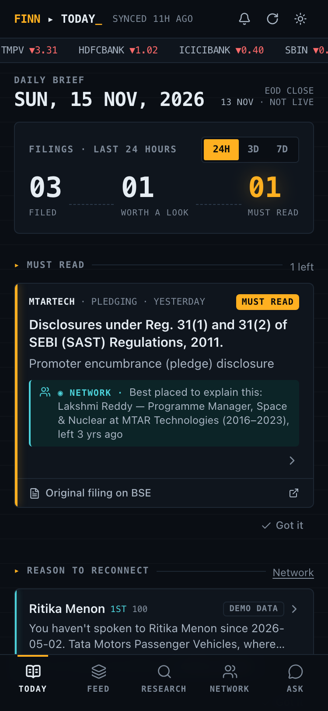
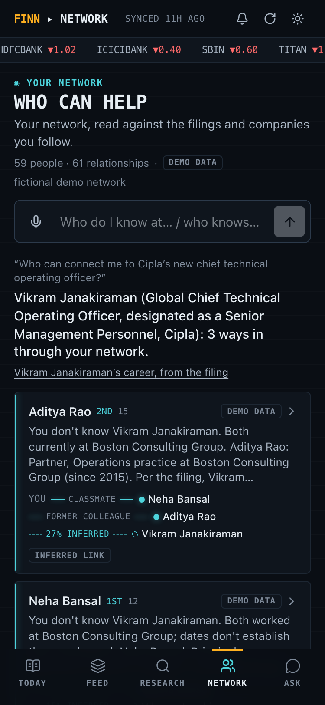
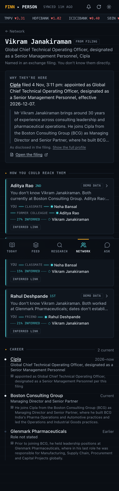
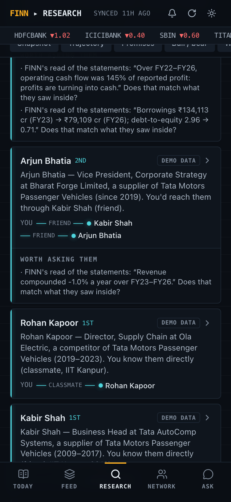
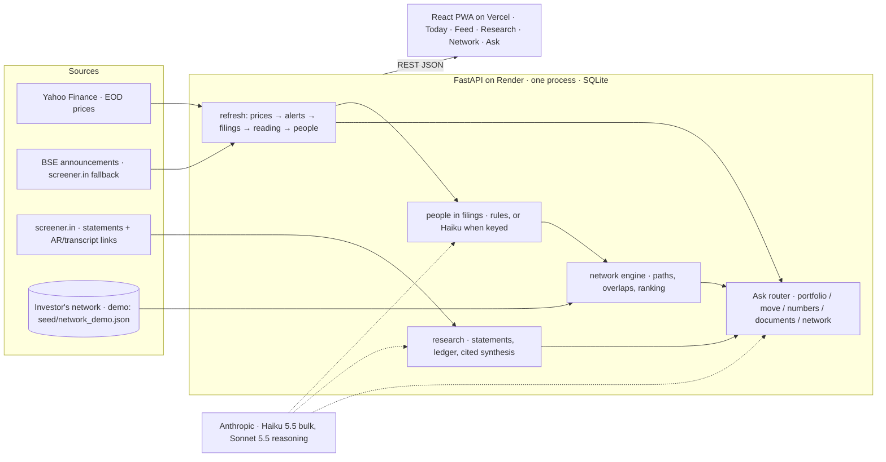

# FINN — Financial Investment Agent

**Yashaswi Raj** · ENAM Holdings — Founding AI Engineer Build Challenge (2027)

- **Live app (open on a phone):** https://finn-founding-f5fz.vercel.app — the free API host sleeps; the first load can take 30–60 s
- **API:** https://finn-api-tz7o.onrender.com/api/health
- **Writeup and requirement map:** [docs/SUBMISSION.md](docs/SUBMISSION.md) · **5-minute walkthrough:** [docs/DEMO_GUIDE.md](docs/DEMO_GUIDE.md)
- **Live demo status:** runs without a model API key, so model-written sections (filing summaries, results cards, the
  Promise Ledger, the business snapshot and the bull/bear case) are labelled "switched off" there; everything else —
  including the whole Network — is live. They run when `ANTHROPIC_API_KEY` is set ([docs/DEPLOY.md](docs/DEPLOY.md)).

FINN is a mobile-first agent for an investor holding 20 NSE companies. It reads the exchange feed, prices and the
companies' own documents so the investor doesn't have to, shows only what matters — and tells them **who in their own
network can help them understand it**.

| Layer | What it does |
|---|---|
| **Push** | A daily brief you can finish: ranked filing digest for any window, price/volume/filing alerts on thresholds you set, results cards with QoQ/YoY, management changes with the incoming person's background **and how you could reach them**. |
| **Pull** | Research on any NSE ticker from its annual report and earnings-call transcripts: snapshot, trajectory, balance sheet, cash quality, a **Promise Ledger** (guided vs delivered), a cited bull/bear case — and **who to call** about the company. |
| **Network** | Who knows whom, who worked where, who is the go-to person for a theme, and who you haven't spoken to whose old company just filed something. Woven into Push and Pull, and askable in plain words. |

| Today | Ask your network | How to reach the new CTO | Who to call |
|---|---|---|---|
|  |  |  |  |

Dark terminal by default (light theme one tap away): amber means "needs your attention", cyan means "your network";
solid glowing lines are relationships you know, dashed ones are overlaps FINN inferred.

## The point of view

Most investor tools add information. FINN removes it.

1. **A brief with an end.** Today shows the funnel ("12 filed → 8 worth a look → 2 must read"), the must-reads and the
   unusual moves. You clear each one; when they're gone, you're done. Routine filings are buried, each still saying why.
2. **Narrative vs numbers is a ledger, not a summary.** Every quantitative promise from the last four calls is stored
   with its verbatim quote and page, then scored by arithmetic. The model finds promises; it never decides if one was kept.
3. **Every claim opens its source.** Numbers link to the statement they come from; model sentences carry citations to
   the exact passage. A point without a source is deleted in code.
4. **The network speaks only when it has something to say.** One line on the filing that matters ("Aditya Rao, via
   Neha Bansal, can get you to Vikram Janakiraman") — not a contact list. It shows how sure it is: a **known**
   relationship (you recorded it) is drawn solid; an **inferred** overlap (FINN computed it from careers) is dashed,
   carries a confidence, and says "verify before relying on it". No model ever invents or describes a relationship.

## What the Network notices — on real filings

These run on real BSE filings from October–November 2026, read **by rules, with no model**:

- **Cipla appoints a Global Chief Technical Operating Officer** (ex-BCG Managing Director, ex-Glenmark manufacturing
  head). FINN parses the filing's profile into a career history, then finds: a contact who is a Partner at BCG today
  (reached through a friend from business school), and a direct friend who ran manufacturing at Glenmark.
- **Cipla's new independent director** was CFO of Castrol India and sits on eight boards. FINN finds a former Castrol
  finance controller you worked with, and someone at Bharat Forge — where she is on the board.
- **HDFC Bank's head of business banking retires** after ~27 years. FINN finds a contact who worked in that business
  2010–2020 (shared years, not just a shared employer).
- **Who to call about Tata Motors**: the ex-Head of Treasury first, then people at a supplier and a competitor — with
  questions drawn from FINN's own reading of the statements.
- **Reconnect**: someone you haven't spoken to since May, whose former employer just filed results.

The investor and every contact are **fictional** (see [Network data](#network-data-synthetic-and-why)); the companies,
filings and executives are real.

## Run it locally

Requirements: **Python 3.12**, **Node 20+** (tested with Node 24).

```bash
# 1. API
cd backend
python3.12 -m venv .venv
source .venv/bin/activate                 # Windows: .venv\Scripts\activate
pip install -r requirements-dev.txt
cp .env.example .env                      # optional: add ANTHROPIC_API_KEY (see below)
uvicorn app.main:app --reload --port 8000

# 2. Web app (second terminal)
cd frontend
npm install
npm run dev                               # http://localhost:5173 (proxies /api to :8000)
```

The first start loads the committed seed snapshot (filings, prices, research, people in filings) and the demo
network, so the app has data immediately. Press the refresh icon in the header to fetch fresh prices and filings
(about a minute).

**On a phone:** `npm run dev` listens on your network — open `http://<your-computer-ip>:5173` on the same Wi-Fi.

**Without an API key** FINN still runs everything except the model-written parts: prices, alerts, rule-based filing
triage, people in management-change filings and their careers, the whole Network, the deterministic research sections,
and the number/move/portfolio/network questions in Ask. AI readings, the Promise Ledger and the bull/bear case are
labelled as switched off.

## Tests

```bash
cd backend && pytest -q                    # 68 tests
cd frontend && npm run build && npm run lint
```

They cover the arithmetic (returns, 20-session volume, QoQ/YoY, loss-to-profit), thresholds and duplicate alerts,
classification, figures that must appear verbatim on the filing page, fabricated quotes, uncited bull/bear points —
and for the Network: people extraction on 10 real filings, career histories that cite their source, 1st/2nd-degree
paths, ranking order, **no invented links** (every edge is a recorded relationship or a computed overlap with
evidence), **investor isolation**, retention, the auth boundary, and that the snapshot never carries private rows.
Details: [docs/TESTING.md](docs/TESTING.md).

## Architecture



- [Architecture and request flows](docs/ARCHITECTURE.md)
- [Data sources and pipelines](docs/DATA_SOURCES.md) · [Database schema](docs/DATABASE_SCHEMA.md) · [API reference](docs/API_REFERENCE.md)
- [Network intelligence](docs/NETWORK_INTELLIGENCE.md) · [LLMs and agents](docs/AI_LLM_ARCHITECTURE.md) · [Security and privacy](docs/SECURITY_PRIVACY.md)
- [Deployment](docs/DEPLOY.md) · [Testing](docs/TESTING.md) · [5-minute demo walkthrough](docs/DEMO_GUIDE.md)
- [Engineering decision log](DECISION.md)

### Repository layout

```
backend/
  app/main.py              FastAPI app, boot sequence, /api/health, /api/me
  app/auth.py              which investor is asking (bearer token; demo mode)
  app/market_data/         Yahoo EOD bars, returns, volume multiples
  app/alerts/              threshold rules, alert history
  app/announcements/       BSE feed (+ screener fallback), rules triage, model reading, results cards
  app/research/            statements, promise ledger, cited synthesis, background jobs, Ask router
  app/network/             people in filings, organisations, the investor's network, paths, ranking, queries
  app/llm/client.py        the only module that calls a model: routing, cache, cost log
  app/routes/              push.py · pull.py · network.py
  scripts/                 build_snapshot.py · generate_network.py
  seed/                    snapshot.json.gz (public data) · network_demo.json (synthetic network)
  tests/                   pytest; fixtures/filings = real BSE filing texts
frontend/src/
  pages/                   Today · Feed · Alerts · Research · Network · Person · Ask
  components/              AnnouncementCard · Network (paths, provenance, Who to call) · Cited · ui
  services/api.ts          fetch wrapper + every payload type
docs/                      architecture, schema, API, network, AI, security, deploy, testing, demo
```

## Configuration

| Variable | Where | Required | Default | Purpose |
|---|---|---|---|---|
| `ANTHROPIC_API_KEY` | API | no | — | Turns on model reading, the Promise Ledger, bull/bear, document Q&A |
| `MODEL_CHEAP` / `MODEL_STRONG` | API | no | `claude-haiku-5-5` / `claude-sonnet-5-5` | Model routing |
| `LLM_ENABLED` | API | no | `true` | Kill switch for all model calls |
| `CORS_ORIGINS` | API | no | `http://localhost:5173,…` | Extra allowed web origins (any `*.vercel.app` is allowed by regex) |
| `DATA_DIR` | API | no | `backend/data` (`/data` in Docker) | SQLite, PDF cache, vector index |
| `VECTOR_SEARCH` | API | no | `true` (`false` on Render) | Semantic search alongside keyword search; needs ~1 GB RAM |
| `AUTO_REFRESH_MINUTES` | API | no | `0` | Periodic refresh on hosts that stay awake |
| `NETWORK_DEMO_MODE` | API | no | `true` | Requests without a token read the synthetic demo network. Set `false` in a real deployment |
| `NETWORK_RETENTION_DAYS` | API | no | `730` | How long a contact is kept before it expires |
| `VITE_API_URL` | Web | in production | — | API base URL; unset locally (Vite proxies `/api`) |

Never commit `.env`; it is git-ignored.

## Data

| Need | Source | Notes |
|---|---|---|
| EOD prices and volume | Yahoo Finance chart API (`.NS`) | Split-adjusted; today's bar ignored until 16:00 IST |
| Filings | BSE announcements API → screener.in index when BSE refuses cloud hosts | NSE's API refuses non-browser clients |
| Fundamentals | screener.in statements + links to annual reports and concall transcripts (BSE / company sites) | Primary documents only on the Pull side |
| People in filings | The filing PDFs themselves (SEBI requires a profile for appointed directors and KMP) | Read by rules; by the cheap model when keyed |
| The investor's network | What the investor records (demo: a synthetic dataset) | Never scraped; never sent to a model |

Portfolio (20): TCS, INFY, WIPRO, HDFCBANK, ICICIBANK, SBIN, RELIANCE, ONGC, NTPC, TMPV (Tata Motors Passenger
Vehicles — `TATAMOTORS` no longer trades after the demerger, and FINN resolves the old name to it), MARUTI, ITC,
HINDUNILVR, SUNPHARMA, CIPLA, LT, BHARTIARTL, TITAN, SUZLON (mid cap), MTARTECH (small cap). Research picks: HAL, BEL,
ASIANPAINT, COALINDIA, POWERGRID. Nothing depends on these lists: any NSE ticker with a screener.in page works.

### Network data: synthetic, and why

The brief allows legitimately accessible profiles, a public dataset, or realistic synthetic profiles. FINN uses:

- **Synthetic contacts** (`backend/seed/network_demo.json`, generated deterministically by
  `backend/scripts/generate_network.py`): 59 fictional people and 61 relationships. Their careers are written to
  overlap the real portfolio companies and the real organisations named in real filings (BCG, Glenmark, Castrol India,
  Bharat Forge, Birlasoft, HDFC Bank, L&T, ONGC, Ministry of Power…), so the demo shows what the Network notices.
  Synthetic people only ever *know* other synthetic people; a link to a real executive is always a computed, labelled
  overlap. Every synthetic row is tagged and shows a "Demo data" chip.
- **Real people only as disclosed in exchange filings**, with the filing as the source of every fact.

**How it would work for real:** the investor imports what they already have the right to use — their own LinkedIn data
export (connections, positions), their CRM and calendar via OAuth (who they met and when), and notes — with consent
recorded per contact. Profiles of people in filings come from the filings; a licensed people-data provider could enrich
them under contract. Scraping LinkedIn is against its terms and is not done.

## Deploying

Backend: Docker on Render (blueprint `render.yaml`, unchanged). Frontend: Vercel (`frontend/vercel.json`, set
`VITE_API_URL`). Pushing to `main` redeploys both. See [docs/DEPLOY.md](docs/DEPLOY.md), including how to rebuild the
seed snapshot with an API key so the deployed demo carries AI readings.

## Troubleshooting

| Symptom | Cause / fix |
|---|---|
| "FINN's server is unreachable" on first load | Free Render instances sleep; wait 30–60 s and retry |
| Feed says "via screener.in index" | BSE refuses Render's IPs; FINN falls back automatically (latest 5 filings per company; the snapshot carries history) |
| AI sections say "switched off" | No `ANTHROPIC_API_KEY`; everything else works |
| Research indexing crashes a small host | Set `VECTOR_SEARCH=false` (keyword retrieval only) |
| Network tab says "Sign-in required" | `NETWORK_DEMO_MODE=false` and no token; set it `true` for the demo |
| `pytest` can't import `app` | Run it from `backend/` |

## What is deliberately left out

- **Real device push notifications.** The data is end of day; an honest in-app brief beats a 3 a.m. buzz.
- **Intraday prices.** EOD only, labelled everywhere.
- **LinkedIn scraping** or any scraping of personal profiles.
- **A network "hairball" graph.** Paths are drawn as short lines because that's what you act on; a force-directed map
  says nothing on a phone.
- **Model-written network explanations.** Templates over evidence: zero cost, nothing invented, no personal data to a model.
- **News, broker notes or the model's own knowledge on the Pull side.** Primary documents only.
- **Multi-user sign-in UI.** The API supports per-investor tokens and isolation; the demo runs one fictional investor.

## Where it goes next

Real network import (LinkedIn export, calendar, CRM) with per-contact consent; Postgres with row-level security;
background workers for refresh and research; device notifications for HIGH items during market hours; model-read
career histories for every person in a filing; and second-degree reach that learns from which introductions worked.
