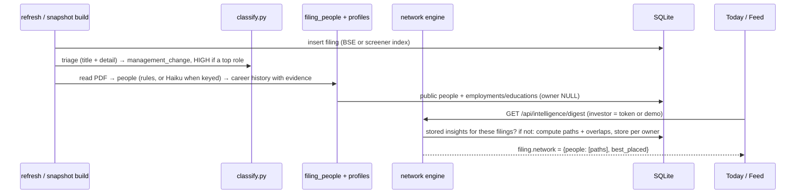

# Architecture

```
React PWA (Vite, Tailwind, Recharts) on Vercel ──HTTPS──▶ FastAPI on Render (Docker, one process)
                                                           ├── SQLite: market data, filings, alerts, research, ledger,
                                                           │           organisations, people, the investor's network, LLM cache + cost log
                                                           ├── SQLite FTS5 + Chroma (local ONNX embeddings): retrieval over primary documents
                                                           ├── Anthropic API: Haiku 5.5 (bulk reading), Sonnet 5.5 (multi-document reasoning)
                                                           └── Adapters: Yahoo Finance (EOD) · BSE announcements (+ screener.in fallback)
                                                                         · screener.in (statements + document index) · PDF upload/URL import
```

## Components

| Module | Job |
|---|---|
| `market_data/` | Yahoo chart endpoint → daily bars; deterministic returns and 20-session volume metrics |
| `alerts/engine.py` | User thresholds, per-company monitoring, per-rule switches; `UNIQUE(symbol, trade_date, rule)` prevents duplicates |
| `announcements/bse.py` | Per-company BSE feed; screener.in index when BSE refuses the host |
| `announcements/classify.py` | Rules over BSE category/subcategory/title/detail → reference category, priority, "needs reading". Catches senior appointments hidden in press releases; "change at the top" goes HIGH |
| `announcements/enrich.py` | Reads only filings whose content decides their importance (Haiku); 4-part summary; people |
| `announcements/results.py` | Results table transcription (Haiku) → Python QoQ/YoY/derived EBITDA; figure verification |
| `document_ingestion/`, `rag/store.py` | Cached download, page extraction, OCR detection, chunks; FTS5 + Chroma hybrid retrieval |
| `research/` | Deterministic statements sections, Promise Ledger, cited synthesis (business, bull/bear), background jobs, Ask router |
| `network/filing_people.py` | People in management-change filings, **by rules** (SEBI disclosure shape, press-release shape) |
| `network/profiles.py` | Filing person → public profile + career history (rules; Haiku with evidence verification when keyed) |
| `network/orgs.py`, `names.py` | Organisation resolution (aliases, normalised names, strict fuzzy match); name normalisation |
| `network/repo.py` | **The only module that touches private network rows**; every function filters by owner |
| `network/graph.py` | Owner's graph in memory; reach (≤2 known hops); career overlaps with confidence |
| `network/rank.py` | Who to call (company), who can get me to (person), go-to people (theme), employer lookup; template explanations; suggested questions from FINN's research |
| `network/insights.py` | Network hints on filings (stored per owner), material-event "best placed", reconnect triggers |
| `network/query.py` | Plain-language network questions → structured filter (rules; Haiku fallback on the question text only) |
| `network/seed.py` | Loads the synthetic demo network |
| `auth.py` | Bearer token → investor; demo mode serves the synthetic investor |
| `llm/client.py` | The only module that calls a model: tiers, response cache, cost log, refusal handling |

## Request flows

### Push: a management change reaches your network



### Pull: research plus who to call

`GET /api/company/{symbol}` returns the research sections (any NSE ticker; old names like TATAMOTORS resolve to their
successor). The page separately calls `GET /api/network/company/{symbol}/contacts`, so research never waits on the
network and the network never enters a research prompt.

### Direct: "who previously worked at Tata Motors?"

`POST /api/network/query` (or Ask, which routes network questions there). Rules turn the question into a filter
(company, theme, role-at-company, reconnect); only if they find nothing does Haiku see the question text. The filter
runs against the investor's own rows.

## Storage

SQLite with plain SQL behind small repository functions. Network tables are additive (`CREATE TABLE IF NOT EXISTS`).
Public rows (organisations, people disclosed in filings) are shared; private rows carry `owner_id` and are only read
through `network/repo.py`. See [DATABASE_SCHEMA.md](DATABASE_SCHEMA.md).

Render's free disk is wiped on restart, so the API boots from `backend/seed/snapshot.json.gz` (public data only) and
loads the synthetic network from `backend/seed/network_demo.json`. Boot sequence (`app/main.py`): connect → load
snapshot if empty → seed companies → re-apply classification rules to model-unread filings → organisations from
companies → demo network if empty → purge expired contacts.

## Cloud: what runs where, and why

| Piece | Where | Why |
|---|---|---|
| Web app | Vercel (static) | Free, global CDN, preview deploys; the app is a static PWA |
| API + SQLite | Render free web service (Docker) | Free; one container holds API, DB and the local embedding model. Sleeps when idle (30–60 s wake) |
| Models | Anthropic API | Haiku for bulk extraction, Sonnet only where multi-document reasoning is needed |
| Seed data | In the repo | Survives Render's ephemeral disk; public data only |

Production path: Postgres (with row-level security on network tables), a worker for refresh/research jobs on a
schedule, object storage for PDFs, secrets in a manager, and the investor's network in its own encrypted schema.

More: [API_REFERENCE.md](API_REFERENCE.md) · [AI_LLM_ARCHITECTURE.md](AI_LLM_ARCHITECTURE.md) ·
[NETWORK_INTELLIGENCE.md](NETWORK_INTELLIGENCE.md) · [SECURITY_PRIVACY.md](SECURITY_PRIVACY.md)
