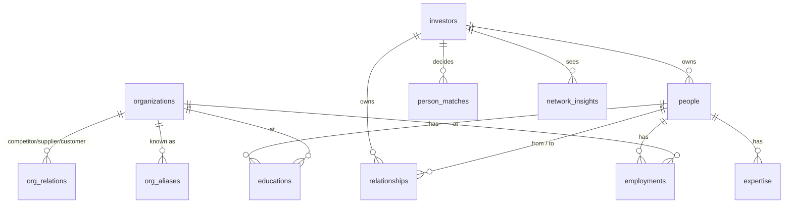

# Database schema

SQLite (`DATA_DIR/finn.sqlite3`), WAL mode, foreign keys on. The full DDL is the `SCHEMA` string in
`backend/app/database/db.py`; tables are created with `CREATE TABLE IF NOT EXISTS`, and column additions to existing
tables go through `_migrate()`. Timestamps are ISO-8601 in IST (`db.now_iso()`); structured blobs are JSON in `*_json`
columns.

## Market, filings, research (public data)

| Table | Key | Purpose |
|---|---|---|
| `companies` | `symbol` | Tracked companies; `in_portfolio`, `is_research_pick`, `sector`, `size_bucket`, BSE code |
| `prices` | `(symbol, date)` | EOD bars |
| `fetch_log` | `(source, key)` | Last attempt and last success per source — freshness labels never lie |
| `announcements` | `id` | Filings: BSE metadata, `category`, `priority`, `priority_score`, `priority_reason`, `category_method` (`rules` or the model), `summary_json`, `card_json` (`results`, `people[]`, `needs_reading`, `people_processed_at`…) |
| `alerts` | `id`; unique `(symbol, trade_date, rule)` | Fired alerts |
| `kv` | `key` | Settings (`alert_settings`), refresh status, snapshot info, and `net:<owner>:<announcement>` markers for computed network views |
| `documents`, `chunks`, `chunks_fts` | `id` | Primary documents, page-bounded chunks, FTS5 index |
| `research` | `(symbol, section)` | Research sections (`financials`, `ledger`, `business`, `bull_bear`) |
| `promises` | `id` | Promise Ledger rows: quote, page, metric, target, due period, outcome, actual |
| `jobs` | `id` | Background research jobs and their steps |
| `llm_calls`, `llm_cache` | | Token/cost log; response cache keyed by a hash of the full input |

## Network

| Table | Key | Columns of note | Owner |
|---|---|---|---|
| `investors` | `id` | `token_hash` (SHA-256 of the bearer token), `self_person_id`, `consent_accepted_at`, `retention_days` | — |
| `organizations` | `id` (`org:<slug>`) | `name_norm` UNIQUE, `symbol` (when listed and tracked), `sector`, `kind` (listed/private/university/government/other), `size_bucket` | public |
| `org_aliases` | `alias_norm` | → `org_id`, `source` (companies_table/curated/self) | public |
| `org_relations` | `(org_id, related_org_id, kind)` | `kind` competitor/supplier/customer/group; `provenance` | public |
| `people` | `id` | `owner_id` (NULL = public figure from a filing), `kind` self/contact/public_figure, `name_norm`, `provenance`, `source_url`, `source_ref`, `notes`, `last_interaction_at`, `consent_basis`, `expires_at` | NULL or investor |
| `employments` | `id` | `person_id`, `org_id`, `title`, `function`, `seniority`, `start_year`, `end_year`, `is_current` (1/0/NULL = not stated), `provenance`, `evidence`, `confidence` | via person |
| `educations` | `id` | `person_id`, `org_id`, `degree`, `end_year`, `provenance`, `evidence`, `confidence` | via person |
| `expertise` | `(person_id, theme)` | `weight` 0–1, `method` declared/derived, `evidence` (declared never overwritten by derived) | via person |
| `relationships` | `id`; unique `(owner, from, to, kind)` | `kind`, `strength` 1–5, `context`, `last_interaction_at`, `provenance` | investor |
| `person_matches` | `(owner, public_person_id, contact_person_id)` | `confidence`, `method`, `status` suggested/confirmed/rejected | investor |
| `network_insights` | `id`; unique `(owner, kind, subject_id, person_id)` | `kind` filing_person/material_event/reconnect, `score`, `payload_json` (the PersonHit), `dismissed_at` | investor |

Indexes: `people(owner_id, name_norm)`, `people(name_norm)`, `employments(org_id, start_year, end_year)`,
`employments(person_id)`, `educations(org_id, end_year)`, `expertise(theme, weight)`,
`relationships(owner_id, from_person_id)`, `relationships(owner_id, to_person_id)`,
`network_insights(owner_id, kind, created_at)`, `organizations(symbol)`.

**First and second degree.** The investor is a person (`self:<investor>`). First degree = relationships touching `self`;
second degree = relationships of those contacts. The engine loads one owner's rows (hundreds) and walks them in Python
(`network/graph.py`); in Postgres the same is a two-level join or a recursive CTE.

**Ownership boundary.** Rows with `owner_id` (and histories of those people) are read only through
`network/repo.py`, which always filters `owner_id = ? OR owner_id IS NULL`. Deleting a person cascades to its
histories, relationships, matches and insights.

## Seed snapshot rules

`backend/seed/snapshot.json.gz` (`services/snapshot.py`) carries public tables only: companies, prices (last 140
sessions), fetch log, filings, alerts, kv (except refresh status and `net:` markers), research, promises, LLM cost log,
organisations/aliases/relations, and **people with `owner_id IS NULL`** plus their histories. It never carries
investors, contacts, relationships, matches, insights or expertise. It loads only into an empty database.

## Migrations

Additive only: new tables via `CREATE TABLE IF NOT EXISTS`; new columns on existing tables via `_migrate()` with
`ALTER TABLE … ADD COLUMN`. Render rebuilds the database from the snapshot on every boot, so no data migration is needed
there. Locally, back up `backend/data/finn.sqlite3` together with its `-wal` and `-shm` files before upgrading.
