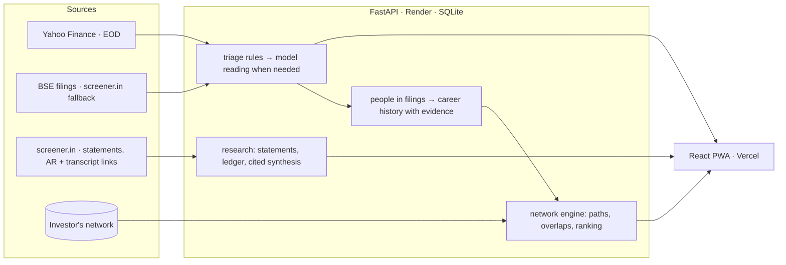

# FINN — submission writeup

**Yashaswi Raj** · ENAM Holdings Founding AI Engineer Build Challenge (2027)

| | |
|---|---|
| Live app (phone) | https://finn-founding-f5fz.vercel.app |
| API health | https://finn-api-tz7o.onrender.com/api/health |
| Repository | https://github.com/YashaswiRJ/finn-founding |
| Walkthrough | [DEMO_GUIDE.md](DEMO_GUIDE.md) |
| Decision log | [../DECISION.md](../DECISION.md) |

The free API host sleeps when idle: the first load can take 30–60 seconds.

## What I built

FINN is a mobile-first agent for an investor holding 20 NSE companies. It has three layers, and the third runs through
the first two.

- **Push** — a daily brief you can finish: a ranked filing digest for any window, alerts on price/volume/filing
  thresholds you set, results cards with QoQ/YoY, and management changes with the incoming person's background read
  from the filing itself.
- **Pull** — research on any NSE ticker from annual reports and concall transcripts: financial snapshot, trajectory,
  balance sheet, cash quality, a **Promise Ledger** (what management guided vs what it delivered, scored by arithmetic)
  and a cited bull/bear case.
- **Network** — who in the investor's own network can help. It speaks as one quiet line on the filing that matters,
  as **Who to call** inside research, and in a Network tab and Ask that answer plain questions.

It works on real filings from October–November 2026:

| Real event | What the Network finds |
|---|---|
| Cipla appoints a Global Chief Technical Operating Officer (ex-BCG Managing Director, ex-Glenmark) | A contact who is a Partner at BCG today, reached through a business-school classmate; a friend who ran manufacturing at Glenmark |
| Cipla's new independent director (ex-CFO Castrol India, eight boards) | A former Castrol finance controller you worked with; someone at Bharat Forge, where she sits on the board |
| HDFC Bank's head of business banking retires after ~27 years | A contact who worked in that business 2010–2020 — shared years, not just a shared employer |
| A promoter-pledge filing at MTAR | The contact best placed to explain it: a former MTAR programme manager |
| Who to call about Tata Motors | The ex-Head of Treasury first, then people at a supplier and a competitor, with questions drawn from FINN's own reading of the statements |

## Key decisions and trade-offs

1. **Known vs inferred.** A *known* link is a relationship the investor recorded. An *inferred* link is a career overlap
   FINN computed (same employer in the same years, a board seat where a contact works, batchmates); it is drawn dashed,
   carries a confidence, and says "verify before relying on it". Confidence is scaled by organisation size — two people
   at a 600,000-person company probably never met.
2. **No model touches relationships.** Paths, overlaps and ranking are code; explanations are templates over evidence.
   Nothing about a person can appear that isn't in the data, and the investor's network never goes to a model.
3. **Quiet by design.** My first version put a "best placed contact" on almost every results filing — noise. It now
   speaks only on the material events the brief names (M&A, capex, litigation) and on management changes with a strong
   enough link: 16 of 82 important filings in the current data.
4. **Rules before models.** SEBI's management-change disclosure has a fixed shape, so people, roles, dates and
   backgrounds are read by rules — the people layer works without an API key. With a key, the cheap model reads the same
   text, and any career row whose evidence isn't verbatim in the filing is dropped. Building this surfaced a real gap: a
   new ONGC chairman and a new Wipro CEO had been filed as routine press releases; the classifier now catches them.
5. **Numbers are never probabilistic.** Returns, QoQ/YoY, promise scoring and network scoring are Python. Models
   transcribe, find and write, and code checks their work: figures and quotes must be on the source page, uncited
   bull/bear points are deleted.
6. **Primary sources only on Pull.** Research uses the company's statements, annual report and call transcripts — no news,
   broker notes or model knowledge. The network never enters a research prompt.

## Architecture

**Data pipelines.** A refresh fetches EOD prices (alerts fire on them), then filings per company from BSE (falling back
to screener.in's index when BSE refuses cloud hosts), triages them by rules, has the model read only filings whose
content decides importance, and turns management-change filings into public profiles whose every career row cites the
filing sentence. Research fetches statements and the annual report and transcripts on demand, chunks them by page and
indexes them for keyword (and, on larger hosts, semantic) retrieval. **Linking:** organisations resolve through aliases,
normalised names and NSE symbols ("TML", "Tata Motors Ltd" and "TATAMOTORS" are one). A name in a filing is matched to a
contact by normalised name plus shared employers, *suggested* to the investor and never merged automatically.
Details: [DATA_SOURCES.md](DATA_SOURCES.md), [NETWORK_INTELLIGENCE.md](NETWORK_INTELLIGENCE.md).

**Security and privacy.** Every private row carries its investor as owner and is read only through one module that
filters by owner (tested with a second investor). Bearer tokens are stored as hashes. Contacts expire after two years
unless renewed; one person or the whole network can be deleted. Consent is confirmed per contact. The network never
enters a model prompt or the committed seed data. Current insiders are flagged ("talk context, not unpublished
numbers"). A real deployment adds SSO, Postgres row-level security, encryption at rest, an audit log and DPDP-compliant
consent records. Details: [SECURITY_PRIVACY.md](SECURITY_PRIVACY.md).

**LLMs and agents.** Haiku 5.5 for bulk extraction (filing reading, results transcription, guidance, career histories);
Sonnet 5.5 only for multi-document reasoning (bull/bear, ledger conclusion, document Q&A) with machine-checkable
citations. Every call is cached by input hash and cost-logged; system prompts are prompt-cached. Ask is a deterministic
tool router — portfolio, price moves, numbers, documents, network — not an autonomous agent: cheaper, faster and easier
to trust here. Details: [AI_LLM_ARCHITECTURE.md](AI_LLM_ARCHITECTURE.md).

**Cloud.** React PWA on Vercel; FastAPI, SQLite and a local embedding model in one Docker container on Render's free
tier. Because that disk is ephemeral, the API boots from a committed seed of public data and loads the demo network from
a committed file. Details: [ARCHITECTURE.md](ARCHITECTURE.md), [DEPLOY.md](DEPLOY.md).

## Network data

The investor and all 59 contacts are **synthetic**, generated deterministically and labelled "Demo data" everywhere.
Their careers deliberately overlap the real portfolio companies and the real executives in current filings, so the
demo shows what the Network notices. Synthetic people only ever *know* other synthetic people. Real people appear only
as disclosed in exchange filings, with the filing as the source of every fact.

**For real use**, the investor would import what they already have the right to use — their own LinkedIn data export,
CRM and calendar via OAuth, their notes — with consent recorded per contact. Profiles of people in filings come from
the filings; a licensed people-data provider could enrich them under contract. No scraping.

## Requirement map

| The brief asks for | Where to see it | Code |
|---|---|---|
| Windowed digest, routine collapsed | Today (24h/3d/7d) · Feed (to 30d), "Buried" | `announcements/service.py` |
| Triggered alerts, configurable thresholds | Bell (top right) → rules and history | `alerts/engine.py` |
| Management change → background + network | Feed → Cipla management change → sheet → "Your network"; person page | `network/filing_people.py`, `profiles.py`, `insights.py` |
| Material event → best-placed person | Today / Feed: MTAR pledge → "Best placed to explain this" | `network/insights.py` |
| Quarterly results → Revenue/EBITDA/PBT/PAT QoQ & YoY | Results cards (need a model key) | `announcements/results.py` |
| Business / financial snapshot, trajectory, balance sheet, cash quality | Research → any ticker | `research/financials.py`, `synthesis.py` |
| Narrative vs numbers, guidance (4 quarters) | Research → Promises (needs a model key) | `research/ledger.py` |
| Bull vs bear | Research → Bull / bear (needs a model key) | `research/synthesis.py` |
| Generalises to any NSE ticker | Research → search any company | `services/companies.py` |
| Who should I call | Research → Who to call; Network → "who previously worked at …" | `network/rank.py` |
| Second-degree reach and link strength | Paths: "You — Classmate — Neha — … ┄ inferred 27% ┄ …" | `network/graph.py` |
| Diligence on people | Person page: career with filing quotes, board seats, "worth asking about" | `routes/network.py` |
| Expertise map | Network → go-to people by theme | `network/themes.py` |
| Keeping the network warm | Today → "Reason to reconnect"; Network → Reconnect | `network/insights.py` |
| Network woven into Push and Pull, and queryable | Filing cards, Research, Network tab, Ask | — |
| Architecture: pipelines, privacy, LLMs, cloud, diagram | This page and `docs/` | — |
| Thin-but-working | 68 backend tests; live demo checked on a 375 px screen | [TESTING.md](TESTING.md) |

## What I left out

Device push notifications (the data is end-of-day), intraday prices, LinkedIn scraping, a network "hairball" graph (a
short path is what you act on), model-written network explanations, news or broker views on the Pull side, and a
multi-user sign-in screen (the API supports per-investor tokens; the demo runs one fictional investor).

## Where I'd take it next

Real network import with per-contact consent; Postgres with row-level security and a background worker; notifications
for HIGH items during market hours; model-read career histories for every person in a filing; and learning which
introductions actually worked, to improve second-degree ranking.
